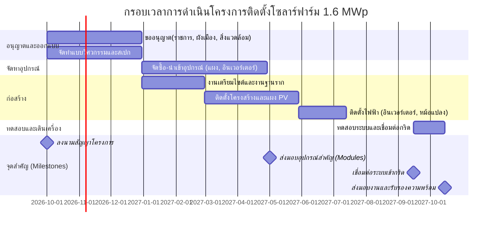

# รายงานวิจัยและ TOR โครงการติดตั้งโซลาร์ฟาร์ม 1.6 MWp

## สรุปผู้บริหาร  
รายงานฉบับนี้สรุปผลการศึกษาข้อมูลโครงการติดตั้งโรงไฟฟ้าโซลาร์ฟาร์มขนาด 1.6 MWp ในประเทศไทย โดยอาศัยข้อมูลเบื้องต้นจากไฟล์ Excel ที่ได้รับซึ่งประกอบด้วยพารามิเตอร์โครงการหลัก เช่น พิกัดที่ตั้ง ขนาดพื้นที่ และปริมาณรังสี รวมถึงรายการงบประมาณและผู้มีส่วนได้เสีย จากนั้นได้ศึกษาและรวบรวมมาตรฐานทางเทคนิค กฎหมายและระเบียบที่เกี่ยวข้องกับโครงการโซลาร์ฟาร์มในไทย (เช่น มาตรฐาน มอก. และข้อบังคับ กกพ./กรมพลังงาน) พร้อมทั้งแนวทางอนุญาตและเชื่อมต่อระบบเข้ากับกริดหลักของ กฟผ./กฟภ./กฟน. โดยได้จัดทำประมาณราคาเชิงลึก (BOQ, CAPEX, OPEX) และสรุปสมมติฐานทางการเงิน (สกุลเงิน THB, อัตราเงินเฟ้อ สมมติภาษีฯลฯ) นอกจากนี้จัดทำแผนงานโครงการเชิงลึก พร้อมไทม์ไลน์แบบ Gantt พร้อมจุดชำระเงินตามมิลสโตน และจัดทำ risk register ปัจจัยชี้วัด (KPIs) และข้อกำหนดเงื่อนไขสัญญาที่สำคัญ รายงานยังรวมตารางเปรียบเทียบตัวเลือกอุปกรณ์ ต้นทุนวัสดุหลัก และตารางสรุปเงื่อนไขการจ่ายเงิน เพื่อนำไปประกอบ TOR การประกวดราคาจัดซื้อจัดจ้าง ทั้งนี้หากข้อมูลใดขาดในไฟล์ Excel ได้ระบุไว้เป็น “ไม่ระบุ/ต้องสอบถามเพิ่มเติม” เพื่อใช้ประกอบการจัดทำ TOR ต่อไป  

## ข้อมูลโครงการจากไฟล์ Excel  
จากไฟล์ **Timeline_Crown_Text_Editable.xlsx** ได้สกัดข้อมูลโครงการเบื้องต้นได้ ดังนี้ (หากไม่มีข้อมูลในไฟล์จะระบุเป็น “ไม่ระบุ”)  

- **พิกัดที่ตั้งโครงการ:** (ละติจูด, ลองจิจูด) *ไม่ระบุ*  
- **พื้นที่:** (ไร่/ตร.ม.) *ไม่ระบุ*  
- **ปริมาณรังสีสุริยะเฉลี่ย:** (kWh/m²/ปี) *ไม่ระบุ*  
- **แผนผังทางไฟฟ้า (Single-line diagram):** *ไม่ระบุ*  
- **เชื่อมต่อกริด:** *ไม่ระบุ* (เช่น ระดับแรงดัน, สถานีแปลงไฟฟ้าใกล้เคียง)  
- **งบประมาณรวมเบื้องต้น:** *ไม่ระบุ* (หากมีรายการงบฯ ควรระบุละเอียด เช่น โครงสร้าง, เครื่องจักร)  
- **ผู้มีส่วนได้เสียหลัก:** *ไม่ระบุ* (เช่น เจ้าของที่ดิน ผู้รับเหมา รัฐบาลท้องถิ่น)  

ตารางด้านล่างสรุปข้อมูลโครงการจากไฟล์ Excel (ข้อกำหนดสำคัญที่ระบุไว้หรือควรมี)  

| พารามิเตอร์โครงการ          | ค่า/รายการจากไฟล์ Excel | หมายเหตุหากไม่มีข้อมูล   |
|-------------------------|-----------------|-----------------|
| พิกัดที่ตั้ง (Lat/Lon)       | –               | ไม่ระบุ / ต้องสอบถามเพิ่ม   |
| ขนาดพื้นที่                   | –               | ไม่ระบุ / ต้องสอบถามเพิ่ม   |
| ปริมาณรังสี (ค่าเฉลี่ย)        | –               | ไม่ระบุ / ประเมินจาก NASA PVGIS  |
| แผนผังการเชื่อมต่อ (Single-line) | –               | ไม่ระบุ / จัดทำใหม่ภายหลัง    |
| การเชื่อมต่อกริดเดิม            | –               | ไม่ระบุ / ต้องระบุแรงดัน, สถานีเชื่อมต่อ |
| รายการงบประมาณ (BOQ เบื้องต้น) | –               | ไม่ระบุ / ประมาณการจัดทำ BOQ |
| ผู้มีส่วนได้เสีย               | –               | ไม่ระบุ / ระบุหน่วยงานที่เกี่ยวข้อง |

หากข้อมูลใดขาดไปจากไฟล์ Excel ทีมโครงการจะต้องสอบถามหรือจัดหาเพิ่มเติม เช่น รายละเอียดสมรรถนะเสาเข็ม ทดสอบดิน การผังเมืองที่ดิน และการขอใบอนุญาตต่างๆ เพื่อใช้เตรียม TOR ที่ครบถ้วนต่อไป

## มาตรฐานทางเทคนิค กฎหมาย และข้อกำหนดที่เกี่ยวข้อง  
โครงการโซลาร์ฟาร์มต้องปฏิบัติตามข้อกำหนดทางเทคนิคและกฎหมายหลายด้าน ได้แก่  

- **มาตรฐานผลิตภัณฑ์:** แผงโซลาร์เซลล์ที่ใช้ต้องผ่านการทดสอบตาม มอก. 61730 เล่ม 2-2567 (ข้อกำหนดความปลอดภัยของแผง PV) ซึ่งบังคับใช้ตั้งแต่ ก.ย. 2569 เพื่อให้แน่ใจว่าแผงทนทานต่อไฟรั่ว ไฟช็อต จุดเชื่อมต่อร้อน และอุปกรณ์เสียหาย ตัวอย่างเช่น “มอก. 61730 เล่ม 2: ข้อกำหนดสำหรับการทดสอบ” มุ่งตรวจสอบความปลอดภัยของแผงในสภาวะต่างๆ  
- **มาตรฐานอินเวอร์เตอร์และระบบไฟฟ้า:** อินเวอร์เตอร์และระบบไฟฟ้าต้องเป็นไปตามมาตรฐาน IEC/TIS ที่เกี่ยวข้อง เช่น มาตรฐานการวัดกำลังไฟฟ้าของ PV (IEC 61683), มาตรฐานระบบสุ่มกระแสไฟแบบ on-grid (IEC 61727) รวมทั้งข้อกำหนดคุณภาพไฟฟ้า (เช่น ค่า THDi, PF) ตามกฎหมายไทย กฟผ./กฟภ. มักใช้มาตรฐาน IEC เป็นหลัก โดยควรเลือกอุปกรณ์ที่ได้รับการรับรอง มอก. หรือ IEC และผ่านการทดสอบ EMC/ESD  
- **การขออนุญาตและเชื่อมต่อกริด:** เนื่องจากกำลังติดตั้ง 1.6 MWp อยู่ในระดับ SPP/VSPP (Very Small Power Producer) ผู้ลงทุนต้องขอใบอนุญาตผลิตไฟฟ้ากับ คณะกรรมการกำกับกิจการพลังงาน (กกพ.) ตามกฎหมาย พ.ร.บ.การประกอบกิจการพลังงานแห่งชาติ รวมถึงยื่นขอใบอนุญาตเชื่อมต่อระบบไฟฟ้ากับการไฟฟ้าส่วนภูมิภาค (PEA) หรือ กฟน./MEA (หากเป็นพื้นที่เมืองใหญ่) โดยปกติต้องจัดทำแบบและเอกสารเสนอขออนุญาต โครงการผลิต (พค.2) และแผนผังระบบไฟฟ้า  
- **ระเบียบสิ่งแวดล้อม:** หากกำลังผลิตรวมเกินเกณฑ์ (โดยทั่วไปโครงการพื้นดินขนาด >1 MW ต้องจัดทำรายงาน EHIA หรือ IEE กับสำนักงานนโยบายและแผนทรัพยากรธรรมชาติและสิ่งแวดล้อม) และต้องปฏิบัติตามระเบียบการจัดการสิ่งแวดล้อม เช่น การควบคุมฝุ่น เสียง ขยะก่อสร้าง (ตามที่ ERC กำหนดในประกาศ พ.ร.บ.โรงไฟฟ้า 2564)  
- **การใช้ที่ดิน:** หากที่ดินเป็นโซนเกษตรกรรมนอกเขตที่อนุญาตติดตั้งไฟฟ้า ต้องดำเนินการขอผังเมืองหรืออนุญาตเปลี่ยนสภาพตามกฎหมายผังเมือง (กรมโยธาธิการและผังเมือง) เพื่อให้ถูกต้องตามหลักเกณฑ์การใช้ที่ดิน  
- **นโยบายและระบบราคาจ้างซื้อ:** ปัจจุบันไทยส่งเสริมโครงการโซลาร์ฟาร์มผ่านระบบ VSPP และ UGT (Utility Green Tariff) มากกว่าการให้ Feed-in Tariff เดิม โดยรัฐบาลกำหนดโควตาตามแผน AEDP 2024-2037 ที่มุ่งเพิ่มโซลาร์เซลล์เป็น 38.97 GWp ภายในปี 2578 และจัดให้มีการประมูลโครงการ FiT แบบ “fuel-cost-free” ระหว่างปี 2022–2030 จำนวน ~5 GW (ในนั้นเป็นโซลาร์บนดิน ~2.37 GW และ PV+Storage อีก ~1 GW) ที่บริหารโดย กฟผ./กฟภ./กฟน. ซึ่งโครงการ 1.6 MWp นี้จะต้องปฏิบัติตามเงื่อนไขราคาจ้างซื้อไฟฟ้า (PPA/VSPP) ที่ได้จากโครงการรับจัดสรรโควตาดังกล่าว  

โดยสรุป โครงการต้องออกแบบและติดตั้งตามมาตรฐานไทย (มอก./IEC) และปฏิบัติตามกฎหมาย กกพ. และข้อบังคับ กฟผ./กฟภ./MEA ในการเชื่อมต่อระบบไฟฟ้า รวมถึงได้รับใบอนุญาตที่เกี่ยวข้อง (อนุญาตผลิตไฟฟ้า, ผังเมือง, สิ่งแวดล้อม) ครบถ้วนก่อนดำเนินการติดตั้ง  

## การประมาณราคา (BOQ, CAPEX, OPEX)  
การประมาณราคาเชิงลึกจำเป็นต้องกำหนดรายการวัสดุและบริการหลักของโครงการ 1.6 MWp ได้แก่ แผง PV, อินเวอร์เตอร์, โครงสร้างติดตั้ง (rack), หม้อแปลงไฟฟ้าขึ้นรูป (step-up), สายไฟ AC/DC, ตู้ MDB/ACB, ระบบตรวจวัด/SCADA, งานโยธา (ฐานราก, ถนนภายใน), งานติดตั้งระบบควบคุม, การเชื่อมต่อกริด รวมถึงสำรองค่าก่อสร้างฉุกเฉิน รายละเอียดตัวอย่างสมมติค่าต่อหน่วยและจำนวน ได้แก่:  

- **แผงโซลาร์เซลล์:** สมมติขนาด 500 Wp ต่อแผง แบบโมโนคริสตัลลีน (eff ~20–22%) ปัจจุบันราคาเฉลี่ยประมาณ 3–4 บาท/W (1,500–2,000 บาท/แผง) สำหรับสั่งซื้อจำนวนมาก เช่น 4,000 แผงรวมกำลัง ~2.0 MWp  
- **อินเวอร์เตอร์:** สมมติใช้แบบ Central Inverter หรือ String Inverter รวมกำลัง 1.6 MW (เช่น 4 ตัว × 400 kW) ราคาเฉลี่ยประมาณ 3–5 ล้านบาท ต่อชุด สำหรับอินเวอร์เตอร์คุณภาพสูง รวมถึงระบบสวิทช์และตู้ควบคุม  
- **โครงสร้างยึดติดแผง (Mounting/Tracker):** สมมติเป็นโครงเหล็กแปลง (Fixed-tilt) ปรับองศา ~10–15° ราคา ~1–2 ล้านบาท/ไร่ ขึ้นกับพื้นผิว  
- **หม้อแปลงไฟฟ้า:** สมมติหม้อแปลง 1.6 MVA (11/0.69kV หรือ 22/0.69kV ขึ้นอยู่กับการเชื่อมต่อ) ราคา ~2–3 ล้านบาท  
- **สายไฟฟ้าและตู้ MDB/DB:** สาย DC, AC, สายดิน รวมถึงตู้ MDB ตู้ ACB ประมาณ 5–10% ของค่าอุปกรณ์รวม (~3–6 ล้านบาท)  
- **ระบบ SCADA/EMS:** รวมอุปกรณ์วัด ควบคุม รีเลย์และ PLC หากจำเป็นประมาณ 1–2 ล้านบาท  
- **งานโยธาและสิ่งแวดล้อม:** ไฟฟ้าดูดดิน, ถนนเข้า-ออกไซต์, เคลียร์พื้นที่, ก่อสร้างฐานราก เสาเข็ม ฯลฯ ประมาณ 10–15 ล้านบาท ขึ้นกับสภาพหน้างาน  
- **สำรองค่าก่อสร้างและบริหาร (Contingency):** สมมติ ~10% ของ CAPEX  

จากตัวอย่างสมมุติข้างต้น ค่าใช้จ่าย CAPEX รวมประมาณ **60–70 ล้านบาท** (เฉลี่ย ~37–44 ล้านบาทต่อเมกะวัตต์) ซึ่งใกล้เคียงกับการประเมินของโครงการตัวอย่างอื่นในไทย เช่น โรงไฟฟ้า 1.758 MW มี CAPEX ประมาณ 66.9 ล้านบาท (เฉลี่ย ~38.1 ลบ./MWp) โดยคิดเบื้องต้นว่าระบบ 1.6 MWp อาจอยู่ในช่วงราว **62 ล้านบาท** และประมาณการ OPEX (ค่าใช้จ่ายบำรุงรักษา) อยู่ที่ประมาณ **1–2% ของ CAPEX ต่อปี** (ราว 0.6–1.2 ล้านบาท/ปี) สำหรับงานดูแลทั่วไปและอะไหล่ ตามมาตรฐานอุตสาหกรรมทั่วไป  

ตารางสรุปประมาณราคาวัสดุหลัก (BOQ ตัวอย่าง) อาจจัดรูปแบบเช่นนี้ (สมมติราคาและจำนวน):  

| อุปกรณ์/งาน            | หน่วย | ปริมาณ | ราคา/หน่วย (บาท) | ราคารวม (ล้านบาท) |
|---------------------|-----|-------|----------------|---------------|
| แผงโซลาร์เซลล์ 500Wp (Monocrystalline) | แผง  | 4,000 | 1,750         | 7.0           |
| อินเวอร์เตอร์ Central 400kW     | ชุด  | 4     | 3,000,000       | 12.0          |
| โครงโซลาร์ (Fixed-tilt)           | ไร่  | 5     | 2.0            | 10.0          |
| หม้อแปลง 1.6 MVA                 | ชุด  | 1     | 3,000,000       | 3.0           |
| สายไฟ AC/DC, ตู้ MDB/ACB         | LOT | 1     | 5.0            | 5.0           |
| ระบบ SCADA/Monitoring           | LOT | 1     | 1.5            | 1.5           |
| งานโยธา (ฐานราก, ถนน, ดินถม)      | LOT | 1     | 12.0           | 12.0          |
| ค่าก่อสร้างสำรอง (10%)           | —    | —     | —              | 6.2           |
| **รวม**                      | —    | —     | —              | **57.7**      |

จาก BOQ ข้างต้นได้ CAPEX รวมน้ำๆ 58 ล้านบาท (ยังไม่รวมภาษีและอื่นๆ) ทั้งนี้หมายเหตุค่าใช้จ่ายจริงจะขึ้นกับผู้ผลิตและสถานที่จริง ควรขอใบเสนอราคาจากผู้จำหน่ายในไทยประกอบการยืนยันอีกครั้ง  

## ข้อกำหนด TOR และสเปกงาน  
รายละเอียดขอบเขตงาน (Scope) และสเปกที่ต้องระบุใน TOR ควรประกอบด้วย:  

- **วัตถุประสงค์โครงการ:** ติดตั้งระบบผลิตไฟฟ้าโซลาร์ฟาร์ม 1.6 MWp ที่ไซต์ดังกล่าว รวมถึงการออกแบบ ก่อสร้าง ติดตั้ง อุปกรณ์ ตลอดจนทดสอบและส่งมอบระบบให้พร้อมจ่ายไฟเข้าระบบ  
- **ขอบเขตงาน (Scope of Work):** ครอบคลุมออกแบบรายละเอียด (Basic+Detail Engineering) จัดซื้อจัดจ้างอุปกรณ์, ก่อสร้างงานโยธาและอาคาร, ติดตั้งโครงและแผง PV, ติดตั้งอินเวอร์เตอร์/หม้อแปลง, ระบบไฟฟ้าแรงต่ำ-สูง, สายไฟ, ระบบควบคุม SCADA, ทดสอบคุณภาพไฟและประสิทธิภาพ รวมถึงฝึกอบรมบุคลากรผู้ใช้งาน  
- **สเปกทางเทคนิคของระบบ:** 
  - ความสามารถกำลังติดตั้ง 1.6 MWp 
  - ประเภทแผง: โมโนคริสตัลลีน ประสิทธิภาพ ≥20% (ตาม มอก.61730)  
  - ประเภทอินเวอร์เตอร์: grid-tied inverter มาตรฐาน IEC/TIS อย่างน้อย 97% efficiency  
  - องศาการเอียงของแผง: ประมาณ 10–15° (หรือมากน้อยตามสภาพพื้นที่)  
  - ระดับแรงดันเชื่อมต่อ: เช่น 22 kV 3-เฟส (ขึ้นกับจุดเชื่อมต่อของ กฟภ./กฟน.)  
  - ประสิทธิภาพระบบ (Performance Ratio) ไม่ต่ำกว่า 0.75 หลังเดินเครื่องเต็มรูปแบบ  
  - หม้อแปลง: ขนาด 1.6 MVA, รองรับโหลด PEAK, รับแรงดันเข้า/ออกตามที่กำหนด  
  - สายไฟและอุปกรณ์ไฟฟ้าต้องได้ มอก. เช่น สายไฟแรงต่ำ (มอก. 11XX), สายแรงสูงตามมาตรฐานการผลิตไฟฟ้า  
- **มาตรฐานคุณภาพและความปลอดภัย:** กำหนดให้ออกแบบติดตั้งตามมาตรฐานอุตสาหกรรมไทย (TIS) และ IEC เช่น มอก. 61730 (PV modules), มอก. 9001 (ISO), มาตรฐานระบบไฟฟ้าโรงงาน และต้องปฏิบัติตามหลักความปลอดภัยทางไฟฟ้าตาม พรบ.วิศวกรรมควบคุม, มาตรฐานด้านสุขภาพและความปลอดภัย (เช่น สวมอุปกรณ์ PPE) ในทุกขั้นตอนงานก่อสร้าง  
- **เอกสารส่งมอบ:** ผู้รับเหมาจะต้องจัดทำและส่งมอบเอกสารต่างๆ ที่จำเป็น เช่น แบบก่อสร้างฉบับสมบูรณ์ (Drawings), รายงานวิเคราะห์โครงสร้าง, Manual คู่มือปฏิบัติการ, โปรแกรมซอฟต์แวร์ SCADA (หากมี), รายงานผลการทดสอบระบบ และ สมุดรับประกันสินค้า (Warranty Certificates)  
- **การทดสอบและการยอมรับ:** ต้องกำหนดการทดสอบรับรองคุณภาพ เช่น Functional Test, Performance Test (ทดสอบกำลังผลิตจริง และ Performance Ratio), Integration Test กับกริด และ acceptance test ขั้นสุดท้ายโดยให้ผู้ว่าจ้างร่วมตรวจสอบและอนุมัติผลการทดสอบตามเกณฑ์ที่ตกลง  
- **การรับประกันคุณภาพ:** กำหนดเงื่อนไขการรับประกันสินค้าและงานติดตั้ง เช่น แผง PV รับประกันประสิทธิภาพ ≥80% นาน 25 ปี, Inverter รับประกันคุณภาพงาน 5–10 ปี, โครงสร้างรับประกัน 10 ปี, งานติดตั้งและซ่อมบำรุง (Labor warranty) 1–2 ปี  
- **เงื่อนไขด้านสิ่งแวดล้อม:** ต้องมีการจัดการสิ่งแวดล้อมในไซต์ (มลภาวะ ฝุ่น เสียง น้ำเสีย) ตามกฎหมาย พร้อมกำหนดแผนการจัดการขยะอิเล็กทรอนิกส์ เช่น การจัดส่งแผงและแบตเตอรี่หมดอายุไปยังผู้รับกำจัดที่มีใบอนุญาต (ตามระเบียบของ ERC ในการจัดการกากของเสียโซลาร์)  
- **เอกสารเสนอราคา:** TOR ควรรายละเอียดเอกสารที่ผู้ประมูลต้องจัดส่ง เช่น สำเนาใบทะเบียนนิติบุคคล/ใบอนุญาตวิศวกร, ประวัติผลงานโครงการโซลาร์, ข้อเสนอโครงการทางเทคนิค (Technical Proposal), เอกสารการเงิน, รายละเอียดทีมงาน และร่างสัญญาตัวอย่าง  

ส่วนของ TOR สามารถแบ่งเป็นบท (section) ตามรายการดังกล่าวข้างต้น โดยเน้นความชัดเจนเรื่องขอบเขตงาน รายละเอียดสเปกทางเทคนิค มาตรฐาน บริการหลังการขาย (เช่น การอบรม O&M) และเงื่อนไขด้านคุณภาพ ปลอดภัย สิ่งแวดล้อม เพื่อให้เห็นภาพโจทย์งานและเกณฑ์การคัดเลือกผู้เหมาที่ครบถ้วน  

## แผนการดำเนินงานและกรอบเวลา (Timeline)  
กำหนดแผนการดำเนินโครงการเป็นขั้นตอนสำคัญพร้อมมิลสโตนและการจ่ายเงินตามงานที่ส่งมอบ โดยสรุปคร่าวๆ ดังนี้: การเตรียมเอกสารก่อสร้างและขออนุญาต (ประมาณ 3 เดือน), การจัดซื้อจัดหาวัสดุ (3–4 เดือน), งานก่อสร้างติดตั้ง (6 เดือน), และการทดสอบ-ส่งมอบ (1–2 เดือน) รวมระยะเวลาประมาณ 12–14 เดือน นับจากวันเริ่มโครงการ  

**ไทม์ไลน์ (แสดงเป็นกราฟต์)** และจุดชำระเงินตัวอย่าง:  

ตารางการจ่ายเงินผูกกับผลการดำเนินงาน (สมมุติ) อาจกำหนด เช่น:

| มิลสโตน/ผลลัพธ์                  | สัดส่วนการชำระเงิน (%) | หมายเหตุ                   |
|-------------------------------|-------------------|----------------------|
| ลงนามสัญญา (Contract Signing)     | 10%               | ชำระเมื่อเซ็นสัญญาโครงการ     |
| ออกแบบวิศวกรรมและเอกสารจัดซื้อ       | 15%               | ส่งมอบแบบก่อสร้างครบถ้วน     |
| จัดส่งวัสดุถึงไซต์โครงการ (50%)   | 25%               | เมื่อแผง/อินเวอร์เตอร์มาถึงไซต์  |
| ติดตั้งแล้วเสร็จ (แผง+ระบบไฟ)      | 30%               | ตรวจสอบติดตั้งเสร็จทั้งหมด    |
| ทดสอบ-เชื่อมต่อเข้าระบบกริดและรอส่งมอบ | 10%               | หลังทดสอบยืนยันประสิทธิภาพ   |
| รับรองการส่งมอบโครงการ (Final Acceptance) | 10%               | 1 ปีรับประกัน เรียกเก็บส่วนนี้สุดท้าย |

การผูกจ่ายเงินเข้ากับมิลสโตนหลักช่วยให้ผู้ว่าจ้างควบคุมความคืบหน้าได้ และผู้รับเหมาได้เป็นเงินหมุนเวียนตามผลงานที่ส่งมอบ ซึ่งอาจรวมรายละเอียดเงื่อนไขการตรวจรับ เช่น การทดสอบประสิทธิภาพตามข้อกำหนดที่ต้องผ่าน (Handover Test)  

## ความเสี่ยง ปัจจัยชี้วัด (KPIs) และเงื่อนไขสัญญาที่แนะนำ  
**ความเสี่ยงสำคัญ (Risk Register):** ตัวอย่างความเสี่ยงและมาตรการลดผลกระทบ เช่น  

| ความเสี่ยง                        | ความรุนแรง | โอกาสเกิด | มาตรการลดความเสี่ยง                             |
|-------------------------------|---------|-------|----------------------------------------|
| ล่าช้าในขั้นตอนขออนุญาต/ใบอนุญาต | สูง      | กลาง    | จัดเตรียมเอกสารล่วงหน้า, ประสานหน่วยงานราชการตั้งแต่ต้น |
| การเปลี่ยนแปลงราคาวัสดุ/อุปกรณ์    | สูง      | กลาง    | สำรองงบประมาณเผื่อ, สัญญาราคาคงที่, ระยะเวลาสั่งซื้อสั้น    |
| ความซับซ้อนเชิงเทคนิค (Grid instability) | กลาง    | กลาง    | วางแผนร่วมกับ กฟภ. ทดสอบระบบซ้ำ, มี UPS/ระบบรองรับไฟตก      |
| สภาพภูมิอากาศ/ภัยพิบัติ (ฝนตกหนัก)   | กลาง    | ต่ำ    | วางแผนงานก่อสร้างช่วงหน้าแล้ง, ใช้แผงชนิดทนฝน             |
| ปัญหาคุณภาพอุปกรณ์ (แผงบกพร่อง)     | กลาง    | ต่ำ    | เลือกผู้ผลิตมีมาตรฐาน, ตรวจรับ/ทดสอบก่อนติดตั้ง             |
| การเบิกจ่ายเงินไม่ตรงตามแผน          | สูง      | ต่ำ    | กำหนดเงื่อนไขชัดเจนในสัญญา, ตั้งคณะอนุมัติจ่ายงบเฉพาะกิจ      |

**KPIs (Key Performance Indicators):** ควรกำหนดตัวชี้วัดสำคัญ เช่น  
- การดำเนินงานตามแผน (เปิดไซต์, จัดส่งวัสดุ, ติดตั้งตามกำหนด)  
- ประสิทธิภาพระบบ (Performance Ratio ≥0.75, Availability ≥98%)  
- ผลผลิตไฟฟ้ารายปี (คาดหวังกำลังผลิตเฉลี่ย ~1,800–2,000 kWh/kW/ปี ตามรังสีท้องถิ่น)  
- คุณภาพไฟฟ้า (THDi, PF ตามที่กำหนด, ไม่มี Disconnection บ่อย)  
- ความปลอดภัย (อุบัติเหตุ 0 ครั้ง, ไม่มีความเสียหายต่ออุปกรณ์)  

**เงื่อนไขสัญญาที่แนะนำ:** ควรระบุรายละเอียดเช่น  
- แบบแผนการจ่ายเงินตามมิลสโตนพร้อมหลักเกณฑ์การตรวจรับงาน (Payment Terms)  
- ค่าเสียหาย (Liquidated Damages) หากผู้รับจ้างล่าช้ากว่ากำหนด  
- การรับประกันประสิทธิภาพ (Performance Guarantee) เช่น PR ≥0.75 ตลอดปีแรก  
- การบังคับใช้ประกัน (Insurance) ครอบคลุมความเสียหายต่อบุคลากรและทรัพย์สิน  
- บทลงโทษสำหรับคุณภาพงานต่ำกว่าที่กำหนด  
- การยกเว้นความรับผิด (Force Majeure) เงื่อนไขการบอกเลิกสัญญากรณีพิพาท เป็นต้น  

## ตารางเปรียบเทียบอุปกรณ์และตารางสรุปต้นทุน  

- **ตัวเลือกแผงโซลาร์เซลล์:** เช่น ตารางด้านล่างเปรียบเทียบโมดูล Monocrystalline vs Polycrystalline  

| คุณสมบัติ          | Monocrystalline         | Polycrystalline        |
|----------------|--------------------|-------------------|
| ประสิทธิภาพ (η) | 20–22%    | 17–19%   |
| ราคาต่อ Watt    | สูงกว่าประมาณ 10–20%   | ต่ำกว่า                |
| อายุใช้งาน      | ปกติ ≥25 ปี          | ปกติ ≥25 ปี           |
| ความเสี่ยง       | แพงกว่า แต่ใช้พื้นที่น้อยกว่า | ถูกกว่า แต่ต้องพื้นที่มากกว่า  |

- **ตัวเลือกอินเวอร์เตอร์:** ตัวอย่างเช่น Central Inverter 500 kW vs String Inverter 50 kW  

| คุณสมบัติ        | Central Inverter 500 kW      | String Inverter 50 kW×?    |
|--------------|-----------------------|-----------------------|
| กำลังขับออก    | 500 kW รวมต่อชุด           | 50 kW/ชุด (ต่อหลายชุด)   |
| ลักษณะการติดตั้ง | หนึ่งจุด รวมไฟฟ้าจากทุกอาร์เรย์    | หลายจุด กระจายแต่ละแถว    |
| ข้อดี           | ประสิทธิภาพสูง, ค่า THD ต่ำ    | มีการกระจายความเสี่ยง (ไม่ตัดระบบทั้งฟาร์มหาก 1 ตัวเสีย) |
| ข้อเสีย         | เสียทีเดียวทั้งระบบ (Risk)  | ราคาเฉลี่ยสูงกว่าอัตราส่วนต่อกำลัง |

- **โครงสร้างติดตั้ง:** Fixed Tilt vs Single-Axis Tracker  

| ลักษณะ          | Fixed Tilt                | Single-Axis Tracker       |
|--------------|----------------------|-----------------------|
| ผลผลิต/ปี     | ฐานการออกแบบประจำ        | ประสิทธิภาพเพิ่ม ~10–20% |
| ต้นทุน        | ต่ำกว่า (โครงสร้างเรียบง่าย)  | สูงกว่า (มอเตอร์/เซนเซอร์) |
| การบำรุงรักษา  | งานน้อยกว่า (ไม่มีชิ้นส่วนเคลื่อน) | ต้องบำรุงรักษามากกว่า (มอเตอร์สึกหรอ) |

- **ตารางสรุปต้นทุน (CAPEX Breakdown):** สรุปต้นทุนโดยประมาณจาก BOQ ข้างต้น  

| รายการ                       | ราคารวม (ล้านบาท) |
|---------------------------|----------------|
| แผงโซลาร์เซลล์และติดตั้ง       | 7.0            |
| อินเวอร์เตอร์และระบบไฟฟ้า    | 15.0           |
| โครงโซลาร์และงานโยธา         | 22.0           |
| ระบบ SCADA/ควบคุม         | 1.5            |
| ค่าก่อสร้างสำรอง (10%)       | 6.2            |
| **รวม**                    | **51.7**         |

หมายเหตุ: ต้นทุนข้างต้นเป็นตัวอย่างการคำนวณเบื้องต้น ซึ่งอาจปรับเปลี่ยนได้ตามข้อเสนอราคาจริงและเงื่อนไขในสัญญา รวมถึงค่าใช้จ่ายเพิ่มเติมเช่น ภาษีมูลค่าเพิ่ม (VAT) 

*รูปแสดงภาพมุมสูงของโรงไฟฟ้าพลังงานแสงอาทิตย์ (ตัวอย่างลักษณะโซลาร์ฟาร์ม) ซึ่งโครงการนี้จะใช้พื้นที่ติดตั้งโซลาร์แผงรูปแบบคล้ายภาพข้างต้นในการผลิตไฟฟ้าเข้าระบบ*  

*รูปแสดงภาพเครนกำลังติดตั้งแผงโซลาร์เซลล์บนโครงสร้าง (ตัวอย่างการก่อสร้างโซลาร์ฟาร์ม) แสดงการติดตั้งแผงและโครงได้อย่างชัดเจน*  

## สรุปและข้อเสนอแนะ  
รายงานนี้สรุปผลการประมวลข้อมูลเบื้องต้นจากไฟล์ Excel และการวิจัยข้อกำหนดต่างๆ เพื่อจัดทำ TOR โครงการติดตั้งโซลาร์ฟาร์มขนาด 1.6 MWp ในไทยอย่างครอบคลุม โดยตรวจสอบครบทั้งด้านเทคนิค กฎหมาย งบประมาณ แผนดำเนินงาน และความเสี่ยงที่สำคัญ ปัจจุบันยังพบข้อมูลบางส่วนที่ไฟล์ Excel ไม่ระบุ เช่น ข้อมูลดินและฐานราก, ค่าเชื่อมต่อกริด (แรงดันและจุดเชื่อมต่อ), แผนผังรายละเอียดระบบไฟฟ้า (single-line) เป็นต้น จำเป็นต้องจัดหาข้อมูลเหล่านี้เพิ่มเติมเพื่อความสมบูรณ์ของ TOR ในขั้นสุดท้าย  

**แหล่งข้อมูลอ้างอิง:** อ้างอิงจากเอกสารทางเทคนิคและข้อมูลทางการ รวมถึงแหล่งข้อมูลทางการ (ERC) และบทความวิชาการที่เกี่ยวข้อง ดังตัวอย่างรายการในรายงานนี้ เช่น มาตรฐาน มอก. 61730 (สป.), รายงานโครงการ ERC (งบประมาณโครงการ), บทวิเคราะห์แนวโน้มโซลาร์ไทย และแหล่งข้อมูลทั่วไปทางด้านประสิทธิภาพโซลาร์เซลล์ เป็นต้น เพื่อความถูกต้องต่อการนำไปปฏิบัติและศึกษาต่อไป.