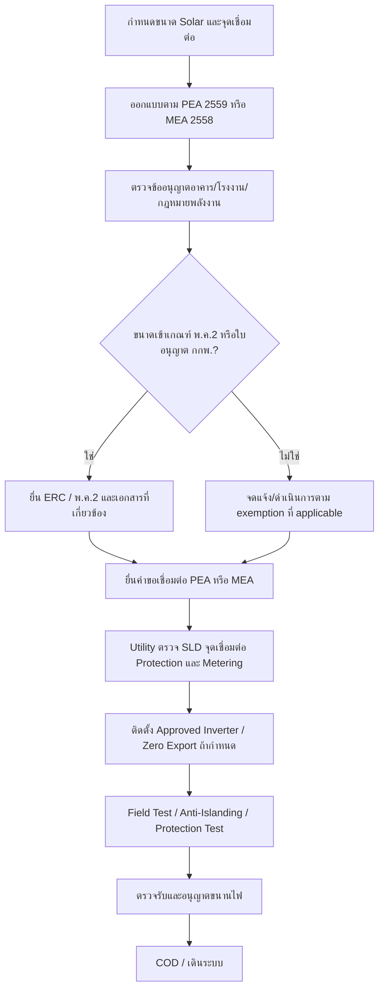
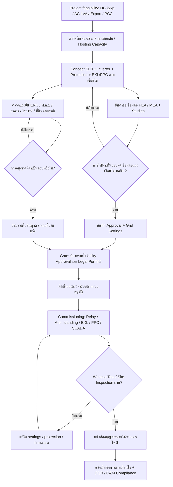

# รายงานวิเคราะห์ผลกระทบ Grid Code ใหม่ของ PEA และ MEA ต่อโครงการ Solar Rooftop และ Solar Ground-Mounted ในประเทศไทย

> **สถานะการตรวจทาน (12 ตุลาคม 2569):** เอกสารนี้ปรับรูปแบบ Markdown และลิงก์อ้างอิงให้ใช้งานบน GitHub ได้ โดยคงข้อวิเคราะห์หลักจากรายงานต้นฉบับลงวันที่ 9 ตุลาคม 2569  เลขอ้างอิงที่ขึ้นต้น `PEA`, `MEA`, `ERC` เป็นลิงก์ไปยังแหล่งข้อมูลภาครัฐ ไม่ใช่รหัสอ้างอิงภายใน ChatGPT  เนื่องจากเอกสาร PEA 2569 หลายฉบับเผยแพร่ผ่าน **หน้าเอกสารรวม** จึงอาจต้องเลือกดาวน์โหลด PDF ฉบับที่ระบุจากหน้านั้นก่อนเปิดอ่านข้อกำหนดรายมาตรา  ข้อสรุปเชิงต้นทุนเป็นเพียงงบประมาณการทางวิศวกรรม ไม่ใช่ใบเสนอราคา/ประกาศอัตราราชการ

> **ข้อควรยืนยันก่อนใช้ยื่นขนานไฟ/ออก TOR:** ใช้ฉบับเอกสารและ technical settings ที่ PEA/MEA รับรอง **ณ วันที่ยื่นโครงการจริง** โดยเฉพาะ MEA Grid Code 2569 ซึ่งรายงานต้นฉบับจัดเป็น **ร่างรับฟังความคิดเห็น** ไม่ใช่ประกาศฉบับสมบูรณ์ และตรวจฐานคำนวณกำลัง AC kVA/จุด PCC ก่อนใช้ threshold ในบทวิเคราะห์

## บทสรุปผู้บริหาร

ณ วันที่ **9 ตุลาคม 2569** สถานะของ Grid Code ของการไฟฟ้าทั้งสองแห่ง **ไม่เหมือนกัน และประเด็นนี้สำคัญมากต่อการตัดสินใจลงทุน**:

**PEA (กฟภ.)** ได้ประกาศ Grid Code พ.ศ. 2569 อย่างเป็นทางการเมื่อวันที่ **10 กันยายน 2569** และกำหนดให้มีผลใช้บังคับตั้งแต่ **10 ธันวาคม 2569** โดยชุดกฎใหม่ประกอบด้วย Connection Code, Service Code และ Operation Code และแทนที่กรอบปี 2559 ในส่วนที่เกี่ยวข้อง ขณะที่หน้า Grid Code ของ PEA ยังแยกประกาศเฉพาะสำหรับ Solar ภาคประชาชน พ.ศ. 2569 ไว้ด้วย  ([PEA26], [PEA26-CC])

**MEA (กฟน.)** แตกต่างออกไป: จากแหล่งทางการที่ตรวจสอบถึงวันตัดข้อมูลนี้ พบ **“ร่าง Grid Code ของ กฟน. พ.ศ. 2569” ที่เปิดรับฟังความคิดเห็น** และระบุทิศทางปรับปรุงเรื่อง Frequency Deadband, Frequency Ride Through และ Frequency Response/Droop แต่ยังไม่พบประกาศ Grid Code 2569 ฉบับ final ที่เผยแพร่ต่อสาธารณะในลักษณะเดียวกับ PEA; ขณะเดียวกัน MEA MyEnergy ยังระบุให้โครงการปฏิบัติตาม Grid Code “ที่ประกาศใช้ ณ ปัจจุบัน” และดำเนินโครงการ Solar ภาคประชาชน พ.ศ. 2569 แยกต่างหากแล้ว ดังนั้นสำหรับ MEA ในรายงานนี้จะแยกให้ชัดระหว่าง **“ข้อกำหนดที่ใช้จริงในโครงการปัจจุบัน”** กับ **“ทิศทางของ Draft Grid Code 2569”** เพื่อไม่ตีความ draft เป็นกฎหมาย final ก่อนเวลา  ([MEA-DRAFT], [MEA-CURRENT])

ผลกระทบสำคัญที่สุดของ PEA 2569 ไม่ใช่การเปลี่ยน anti-islanding เพียงอย่างเดียว แต่คือการเปลี่ยนบทบาทของ inverter จากอุปกรณ์ที่ “หยุดจ่ายเมื่อ grid ผิดปกติ” ไปสู่ **grid-supporting inverter** ที่ต้องมีความสามารถ Active Power Control, PF control, Volt-Var, Volt-Watt, Frequency Ride Through และ—สำหรับระบบ inverter รวมมากกว่า 50 kW ที่เชื่อมต่อ 22 kV ขึ้นไป—Frequency Response และ Voltage Fault Ride Through ตามเกณฑ์ใหม่ โดย inverter ต้องผ่าน type test/การรับรองตามวิธีที่ PEA กำหนดด้วย  ([PEA26-CC])

ผลต่อโครงการ **rooftop ขนาดเล็กที่ต่อ LV** จึงค่อนข้างจำกัด หากเลือก inverter รุ่นที่ผ่านการขึ้นทะเบียนใหม่ตั้งแต่ต้น แต่ระบบที่ต้องจำกัดการส่งออกจะมีต้นทุน Export Limiting Device/Controller เพิ่มขึ้น โดย PEA 2569 กำหนด EXL อย่างชัดเจนในกรณีที่ installed capacity สูงกว่าปริมาณที่ได้รับอนุญาตให้ส่งออก เช่น single-phase ที่ inverter ติดตั้งเกิน 7 kW แต่ส่งออกไม่เกิน 5 kW และกรณี multi-phase ตาม threshold ที่กำหนด ขณะเดียวกัน aggregate generation บนหม้อแปลงจำหน่ายมีเกณฑ์ที่ต้องตรวจสอบด้วย  ([PEA26-CC])

ผลกระทบจะสูงขึ้นชัดเจนสำหรับ **C&I rooftop และ ground-mounted ที่ต่อ 22/33 kV** เพราะ threshold มากกว่า 50 kW ทำให้ Frequency Response/FRT และ Voltage Fault Ride Through เข้ามาเกี่ยวข้อง และเมื่อโครงการมีขนาดมากกว่า 1 MW จะมี monitoring/real-time data และอาจมี SCADA/remote-control obligations เพิ่มขึ้น ในบางกรณี PEA ยังสามารถกำหนด synchronizing, teleprotection, inter-trip หรือ block-reclosing เพิ่มเติมโดยให้ผู้เชื่อมต่อรับผิดชอบค่าใช้จ่าย  ([PEA26-CC])

ด้าน CAPEX ผลกระทบ **ไม่ควรตีความว่า inverter ทุกเครื่องจะราคาแพงขึ้นเป็นเปอร์เซ็นต์สูง** เพราะ inverter utility-scale รุ่นใหม่จำนวนมากมีฟังก์ชันเหล่านี้อยู่แล้ว; ต้นทุนที่เสี่ยงเพิ่มจริงมักอยู่ที่ plant controller/PPC, EXL, protection, RTU/SCADA, communication, testing/certification และ network reinforcement. จากแบบจำลองต้นทุนในรายงานนี้ ประเมิน incremental CAPEX โดยทั่วไปประมาณ **+1–5% สำหรับระบบใหม่ที่ออกแบบตาม code ตั้งแต่ต้น** แต่ retrofit หรือโครงการที่ต้องเพิ่ม feeder/substation/inter-trip สามารถสูงกว่า **5–15%** ได้ และค่า grid reinforcement อาจสูงถึงหลายล้านหรือหลายสิบล้านบาทโดยไม่สามารถกำหนดเป็นเปอร์เซ็นต์เดียวได้ เนื่องจากขึ้นกับจุดเชื่อมต่อและ hosting capacity. ตัวเลขเหล่านี้เป็น **engineering estimate ไม่ใช่อัตราราชการ**; PEA ระบุชัดว่าค่า communication/SCADA และอุปกรณ์บางส่วนเป็นภาระของผู้เชื่อมต่อ  ([PEA26-CC])

ด้านการอนุญาต **Grid Code 2569 ไม่ได้ยกเลิก พ.ค.2 หรือแทนที่ใบอนุญาตตามกฎหมายพลังงาน**. ปัจจุบัน กกพ. แยกโครงการที่เชื่อมกับ grid เป็นกลุ่มต่ำกว่า 200 kVA กับกลุ่มตั้งแต่ 200 kVA แต่ต่ำกว่า 1,000 kVA โดยกลุ่มหลังยังต้องขอ **ใบอนุญาตให้ผลิตพลังงานควบคุม (พ.ค.2)**; กกพ. มีขั้นตอนและ checklist พ.ค.2 ภายใต้กฎหมายพัฒนาและส่งเสริมพลังงานโดยเฉพาะ ส่วนการอนุญาตให้ “ขนานไฟ” เป็น technical acceptance จาก PEA/MEA หลังแบบ อุปกรณ์ settings และ commissioning ผ่านข้อกำหนด grid connection. สิ่งที่ Grid Code ใหม่เปลี่ยนจึงเป็น **technical gate ก่อนออกใบขนานไฟ** มากกว่าการสร้างใบอนุญาตราชการชนิดใหม่  ([ERC-EXEMPT], [ERC-PM2])

**ข้อแนะนำหลักสำหรับ developer:** สำหรับโครงการใหม่ในเขต PEA ที่ COD หลัง 10 ธันวาคม 2569 ควร tender ด้วย specification 2569 ตั้งแต่ต้น; สำหรับ MEA ควรออกแบบ inverter/PPC ให้รองรับทิศทาง Draft 2569 แต่ระบุใน EPC contract ว่า final settings ต้องเป็นค่าที่ MEA อนุมัติ ณ วัน energization. โครงการตั้งแต่ 50 kW ขึ้นไปที่อาจต่อ MV ควรตรวจ FRT/droop capability ก่อนสั่ง inverter และโครงการระดับ MW ควรทำ SCADA/protection/communication design พร้อม grid study ตั้งแต่ feasibility แทนที่จะรอหลังติดตั้งอุปกรณ์แล้ว. ข้อเสนอเหล่านี้เป็นผลโดยตรงจาก threshold และ functional requirements ที่ปรากฏใน PEA 2569 และทิศทาง draft MEA 2569.  ([PEA26-CC], [MEA-DRAFT])

## สถานะกฎใหม่และสาระที่เปลี่ยนในเชิงนโยบาย

### สถานะของ PEA

หน้า [ประกาศและข้อกำหนด Grid Code ของ PEA](https://www.pea.co.th/business-partner/regulation) ระบุว่า PEA ประกาศ Grid Code พ.ศ. 2569 เมื่อวันที่ **10 กันยายน 2569** และมีผลหลัง 90 วัน คือวันที่ **10 ธันวาคม 2569** พร้อมเผยแพร่ Connection Code, Service Code และ Operation Code ใหม่ ส่วน Grid Code 2559 และประกาศแก้ไขระหว่างทางยังถูกเก็บไว้เป็นข้อมูลอ้างอิง.  ([PEA26])

Connection Code ใหม่ขยายและจัดหมวดผู้เชื่อมต่อให้ชัดขึ้น ครอบคลุม VSPP, SPP, ผู้ใช้ไฟฟ้าที่มีเครื่องกำเนิดไฟฟ้า, การใช้ระบบโครงข่ายโดยบุคคลที่สาม และผู้ประกอบกิจการประเภทอื่น และให้ PEA มีอำนาจกำหนด technical requirements เพิ่มเติมเป็นรายกรณีตามผลกระทบต่อโครงข่าย.  ([PEA26-CC])

ทิศทางสำคัญคือเปลี่ยนจากแนวคิด “disconnect เมื่อผิดปกติ” ไปเป็น **DER ที่ช่วยพยุง grid ในช่วง disturbance** มากขึ้น เช่น Volt-Var, Volt-Watt, Frequency Ride Through, Frequency Response และ VFRT ขณะที่ยังคง anti-islanding เพื่อป้องกัน unintended island.  ([PEA26-CC])

อีกส่วนที่มีผลต่อ developer โดยตรงคือ PEA ใส่ hosting/export criteria ที่ชัดขึ้น: generation ที่เชื่อมรวมกับ distribution transformer มีเกณฑ์ aggregate capacity, feeder 22 kV มีเกณฑ์ export รวมสูงสุด **8 MW/circuit**, 33 kV **10 MW/circuit**, และกำลังรวมของวงจรที่เกี่ยวข้องมีเงื่อนไขเทียบกับ transformer capacity ของสถานี รวมถึงใช้ EXL หาก installed generation สูงกว่าปริมาณ export ที่ได้รับอนุญาต.  ([PEA26-CC])

### สถานะของ MEA

หน้า [MEA MyEnergy](https://myenergy.mea.or.th/) ในปัจจุบันระบุว่า self-consumption solar ที่ขนานกับระบบ MEA ต้องยื่นคำขอเชื่อมต่อและเป็นไปตาม Grid Code “ซึ่งประกาศใช้ ณ ปัจจุบัน”; ส่วน Solar ภาคประชาชน 2569 เปิดรับคำขอตั้งแต่ **1 กรกฎาคม 2569** และเปิดให้ขายไฟส่วนเกินไม่เกิน 5 kW/มิเตอร์ ภายใต้โครงการรับซื้อ 2.20 บาท/kWh เป็นเวลา 10 ปี.  ([MEA-CURRENT], [MEA-SOLAR69])

ในทางกลับกัน แหล่งทางการบนระบบรับฟังกฎหมายระบุชื่อเอกสารว่า **“ร่าง Grid Code ของ กฟน. พ.ศ. 2569 (ฉบับปรับปรุง)”** และอธิบายว่าฉบับเดิมคือ Grid Code 2558 โดยหนึ่งในสาระสำคัญของ draft คือการปรับ frequency-control requirements ให้สอดคล้องกับ EGAT ผ่าน Frequency Deadband, Frequency Ride Through และ Frequency Response (% Droop).  ([MEA-DRAFT], [MEA-CURRENT])

ดังนั้นในการทำ financial close หรือออก EPC specification **ไม่ควรเขียนว่า “MEA Grid Code 2569 final” โดยไม่มีเงื่อนไข** ณ วันตัดข้อมูลนี้ แนวทางที่ปลอดภัยคืออ้างอิง “MEA Grid Code in force + project-specific 2569 requirements + latest approved settings issued by MEA” และให้ Change in Grid Code clause รองรับเมื่อฉบับ 2569 final มีผลใช้จริง. ข้อสรุปนี้เป็นการอนุมานจากสถานะ official consultation เทียบกับถ้อยคำใน MyEnergy ที่ยังอ้างถึง code ซึ่ง “ประกาศใช้ ณ ปัจจุบัน”.  ([MEA-DRAFT], [MEA-CURRENT])

## การเปรียบเทียบข้อกำหนดทางเทคนิคเดิมกับใหม่

ตารางต่อไปนี้เน้น “ผลต่อการออกแบบ” มากกว่าการถอดข้อความทุกมาตรา และแยก MEA Draft ออกจากกฎ final อย่างตั้งใจ.

| Technical requirement | PEA เดิม: Grid Code 2559 | PEA ใหม่: Grid Code 2569 | MEA เดิม / current baseline | MEA 2569: สิ่งที่ยืนยันได้ ณ 9 ต.ค. 2569 |
|---|---|---|---|---|
| **Interconnection / hosting capacity** | ใช้ connection configuration และพิจารณาความสามารถของระบบเป็นหลัก | ระบุ export/hosting criteria ชัดขึ้น รวมถึง aggregate บน transformer, 22 kV ≤8 MW/circuit, 33 kV ≤10 MW/circuit และเงื่อนไขระดับสถานี; installed capacity มากกว่า allowed export ต้องมี EXL.  ([PEA26-CC]) | Grid Code 2558 ใช้กับผู้ประกอบกิจการ/ผู้ขนาน generator; สำหรับ self-use หลักเดิมเน้นป้องกัน reverse flow.  ([MEA-CURRENT]) | Solar ภาคประชาชน 2569 ปัจจุบันเปิด export สูงสุด 5 kW/มิเตอร์ภายใต้โครงการเฉพาะ แต่ไม่ควรถือว่าเท่ากับการอนุญาต export ทั่วไปของ Grid Code ทุกประเภทโครงการ.  ([MEA-CURRENT], [MEA-SOLAR69]) |
| **Inverter eligibility** | มีการทดสอบ inverter และ functional tests อยู่แล้ว รวม Active Power, PF/reactive, voltage, anti-islanding, LVRT ฯลฯ.  ([PEA59-CC]) | ต้องใช้ inverter ที่ผ่านวิธีทดสอบ/ขึ้นทะเบียนของ PEA และต้องตั้ง Grid Parameter ได้; test matrix ใหม่รวม Active/Reactive Power, voltage control, FRT, Frequency Response และ VFRT.  ([PEA26-CC]) | MEA ใช้ระบบ approved/listed inverter โดยคำขอเชื่อมต่อกำหนดข้อมูลยี่ห้อ รุ่น และ firmware ของ inverter.  ([MEA-SELF]) | Draft มุ่งสู่ smart-inverter/grid-support functions มากขึ้น; final approved models/settings ต้องตรวจสอบกับ MEA ตอนยื่นจริง.  ([MEA-DRAFT]) |
| **Active-power control** | Inverter ต้องลด P จาก 100% ถึง 0% ได้ และมี ramp/control capability อยู่แล้ว.  ([PEA59-CC]) | หลักเดิมยังอยู่ โดยกำหนดความสามารถลด output 100→0% และอย่างน้อย 10%/min; เชื่อมโยงกับ Volt-Watt และ remote dispatch มากขึ้น.  ([PEA26-CC]) | มีข้อกำหนดการควบคุมตามประเภท connection/project | Draft 2569 สนับสนุนการทำงานของ DER เป็น controllable resource มากขึ้น แต่ยังไม่ควรระบุ final numerical setpoint นอกเอกสารอนุมัติของ MEA.  ([MEA-DRAFT]) |
| **Reactive power / PF** | PEA 2559 มี requirement/test capability ถึงประมาณ PF 0.90 lagging–leading และมีการทดสอบ Q(U)/reactive capability แล้ว.  ([PEA59-CC]) | กำหนดอย่างชัดว่า inverter ต้องทำ PF อย่างน้อย **0.90 lag ถึง 0.90 lead** ที่ rated P และต้องรองรับ Constant PF พร้อม Voltage Control.  ([PEA26-CC]) | Reactive/PF control มีอยู่ตาม connection type แต่ framework เดิมมาจาก Grid Code 2558 | Draft มีการปรับเรื่อง reactive/grid-support capability; final curve/settings ยังต้องอิงฉบับที่ MEA อนุมัติจริง.  ([MEA-DRAFT]) |
| **Volt-Var** | มี reactive/voltage testing แต่ไม่ได้วาง smart-inverter operating requirement แบบชัดเท่าฉบับใหม่.  ([PEA59-CC]) | กำหนด **Volt-Var/Q(V)** เป็นหนึ่งใน voltage-control modes และให้เริ่มทำงานได้ตั้งแต่ P ประมาณ 20% ของ rating.  ([PEA26-CC]) | การควบคุมแรงดันขึ้นกับ code/settings ที่ MEA กำหนด | แนวทาง DER ของ MEA มุ่งใช้ inverter functions เพื่อควบคุม voltage มากขึ้น แต่ draft final settings ยังไม่ยืนยันในประกาศ final ที่ค้นพบ.  ([MEA-DRAFT]) |
| **Volt-Watt** | ไม่มี operating requirement ที่เด่นชัดเท่าฉบับ 2569 | กำหนด **Volt-Watt/P(V)** โดยตรงเป็น voltage-control mode ของ inverter.  ([PEA26-CC]) | ไม่ควรสมมติว่าทุก inverter เดิมมี P(V) ที่ MEA ยอมรับ | แนวทาง smart inverter/hosting-capacity ของระบบจำหน่ายรองรับ Volt-Watt มากขึ้น; final MEA settings ต้องตรวจรุ่นและ firmware ที่ได้รับอนุมัติ.  ([MEA-DRAFT], [MEA-SELF]) |
| **Anti-islanding** | เป็นหัวข้อบังคับและ field/type test ใน code เดิม.  ([PEA59-CC]) | ยังคงเป็นข้อบังคับ; เมื่อ grid ที่ PCC ดับต้องแยกออก และ inverter test ใช้ IEC 62116; code ใหม่ระบุ response เข้มขึ้น รวมถึง disconnect ภายในกรอบเวลาที่กำหนด.  ([PEA26-CC]) | เป็น core requirement ของ MEA Grid Code และ commissioning อยู่แล้ว | ไม่ใช่ประเด็นที่ “เพิ่มใหม่” แต่ interaction กับ FRT ต้องออกแบบให้ไม่เกิด nuisance trip หรืออยู่ island โดยไม่ได้รับอนุญาต. Draft ใหม่จึงเพิ่มความซับซ้อนของ settings มากกว่าการเพิ่ม anti-islanding จากศูนย์.  ([MEA-DRAFT]) |
| **Voltage Fault Ride Through** | PEA 2559 มี Low-Voltage FRT สำหรับ MV/HV โดย threshold เดิมที่สำคัญอยู่ที่ generation **>500 kW**; LV และ MV/HV ≤500 kW ไม่ได้มี requirement เดียวกัน.  ([PEA59-CC]) | Inverter aggregate **>50 kW และต่อ 22 kV ขึ้นไป** เข้า VFRT requirement; ต้องอยู่เชื่อมต่อใน fault envelope และมี reactive-current response ภายใน capability ของอุปกรณ์.  ([PEA26-CC]) | Existing MEA code มี disturbance/protection framework | Draft 2569 ยกระดับ ride-through/frequency-control alignment แต่ตัวเลข final ควรใช้จากฉบับ promulgated/connection approval เท่านั้น.  ([MEA-DRAFT]) |
| **Frequency Ride Through** | ฉบับ 2559 เน้น under/over-frequency protection และไม่มี grid-support deadband/droop framework แบบ 2569 | Inverter ต้องสามารถอยู่เชื่อมต่อใน frequency envelope ที่กำหนด; PEA 2569 ระบุช่วง FRT **47–52 Hz** ใน inverter requirements.  ([PEA26-CC]) | เดิมมี frequency protection ตาม Grid Code 2558 | Draft MEA 2569 ระบุชัดว่าปรับปรุง **Frequency Deadband, Frequency Ride Through และ Frequency Response (%Droop)** ให้สอดคล้องแนวทาง EGAT.  ([MEA-DRAFT]) |
| **Frequency Response / droop** | ไม่มี requirement สำหรับ inverter DER ขนาดเล็กในรูปแบบเดียวกับ 2569 | สำหรับ inverter aggregate **>50 kW ที่เชื่อม 22 kV ขึ้นไป:** deadband 50 ±0.3 Hz และ droop 4% หรือ equivalent 50% power/Hz; PEA สงวนสิทธิ์เปลี่ยน setting.  ([PEA26-CC]) | เดิม frequency response ไม่ได้ถูกเน้นในระดับ DER เท่าร่างใหม่ | เป็นหนึ่งใน changes ที่ MEA ระบุอย่างชัดใน consultation.  ([MEA-DRAFT]) |
| **Protection / reclosing** | Protection scheme ผูกกับ connection configuration และมี relay/protection requirements | PEA สามารถกำหนด synchronization, teleprotection, inter-trip และ block reclosing เพิ่มเติมเพื่อ coordination โดยผู้เชื่อมต่อรับผิดชอบค่าใช้จ่าย.  ([PEA26-CC]) | Protection coordination และ anti-islanding อยู่ใน baseline | คาดว่าจะต้อง coordinate settings กับ ride-through มากขึ้น; เนื่องจาก final code ยังไม่พบ จึงไม่ควร lock relay settings จาก draft เพียงอย่างเดียว.  ([MEA-DRAFT]) |
| **Export limiting / zero export** | Self-use ใช้แนวทางป้องกัน export ตามประเภทโครงการ แต่ threshold EXL ไม่ได้จัดเป็น framework เดียวเท่าฉบับใหม่ | EXL ถูกผูกกับ installed capacity เทียบ allowed export โดยตรง; เช่น 1-phase >7 kW แต่ export ≤5 kW ต้องมี EXL และมี thresholds สำหรับ multi-phase.  ([PEA26-CC]) | Grid Code 2558 สำหรับ parallel self-generation เคยกำหนดไม่ให้ reverse flow ในบริบท self-use; ERC Sandbox เคยต้อง “ผ่อนปรน” requirement นี้เพื่อทดลอง trading.  ([MEA-CURRENT]) | Solar ภาคประชาชน 2569 อนุญาต export ภายใต้โครงการเฉพาะได้ถึง 5 kW/มิเตอร์; self-use นอกโครงการต้องยึด connection approval ของ MEA.  ([MEA-CURRENT]) |
| **Monitoring / PQ meter** | PEA 2559 กำหนด PQ meter สำหรับ generation รวม >1 MW และยังรวม converter aggregate >250 kW พร้อม real-time monitoring/communication.  ([PEA59-CC]) | Code ใหม่กำหนด monitoring สำหรับกลุ่ม >1 MW และให้บันทึก V, I, f, P/Q หรือ PF, THDv/THDi, Pst/Plt; solar/wind อาจถูกขอ irradiance/temperature ฯลฯ และ PEA ต้องเข้าดู real-time ได้.  ([PEA26-CC]) | Metering/monitoring ขึ้นกับขนาดและประเภทโครงการ | ไม่พบประกาศ final ที่ยืนยัน threshold ใหม่ต่างจากเดิม; ให้ตรวจ connection offer เป็นรายโครงการ.  ([MEA-DRAFT], [MEA-CURRENT]) |
| **SCADA / remote control** | PEA 2559 มี RTU/RCS/SCADA อยู่แล้วใน connection configurations บางแบบ และ developer รับผิดชอบ communication cost.  ([PEA59-CC]) | บทบาทกว้างขึ้น: VSPP >1 MW และโครงการอื่นที่ PEA กำหนดต้องรองรับ remote command/setpoint เช่น Voltage, MVar, MW และ PF; ค่าอุปกรณ์ การเชื่อมต่อ ทดสอบ และรายเดือนเป็นภาระผู้เชื่อมต่อ.  ([PEA26-CC]) | MEA มี SCADA/data communication สำหรับโครงการขนาดใหญ่ตามประเภท connection | ไม่มีข้อมูล public-final เพียงพอที่จะสรุป threshold ใหม่ต่างจากเดิม; ควรเผื่อ RTU/PPC interface ใน plant design ระดับ MW. |
| **Communication redundancy** | PEA 2559 กำหนดอย่างน้อย 2 communication channels โดย ≤1 MW บางประเภทใช้ 1 channel.  ([PEA59-CC]) | หลักการใกล้เคียงเดิม: โดยทั่วไป 2 ช่องทาง; ≤1 MW อย่างน้อย 1 ช่องทาง และผู้เชื่อมต่อรับผิดชอบต้นทุน.  ([PEA26-CC]) | ขึ้นกับ connection type | ไม่มี final change ที่ยืนยันได้จากข้อมูลสาธารณะที่ค้นพบ. |
| **Type testing / certification** | มี inverter tests รวม anti-islanding, utility recovery, load rejection, power quality และ reactive capability.  ([PEA59-CC]) | Test matrix อัปเดตเป็น PEA:2026; ห้องทดสอบต้องเป็น ISO/IEC 17025/ได้รับการยอมรับ และ foreign lab ต้องผ่าน verification ที่ PEA ยอมรับ; มี FRT, Frequency Response และ VFRT tests เพิ่มตาม threshold.  ([PEA26-CC]) | MEA ใช้ approved inverter/model/firmware process | ความเสี่ยงหลักคือ model/firmware compatibility เมื่อ final 2569 ออก ไม่ใช่เพียงยี่ห้อ inverter. MEA application ปัจจุบันเก็บข้อมูลรุ่นและ firmware อยู่แล้ว.  ([MEA-SELF]) |
| **Commissioning / field test** | PEA เดิมมี anti-islanding, utility recovery, load rejection, voltage/frequency/harmonic/voltage fluctuation และ reactive capability tests.  ([PEA59-CC]) | Functional scope เพิ่มความสำคัญของการตรวจ Grid Parameter และความสามารถใหม่ของ inverter/PPC; type test ไม่ได้ทำให้ site commissioning หายไป.  ([PEA26-CC]) | MEA ตรวจ equipment, SLD และ commissioning ก่อนอนุญาต parallel | สำหรับโครงการ 2569 ต้องเตรียมหลักฐาน inverter/firmware/controller ให้ตรง approved list และ approved settings; final detailed test matrix ต้องยืนยันกับ MEA ในขั้น connection approval.  ([MEA-SELF]) |

### ประเด็นที่มักถูกเข้าใจผิด

ข้อแรกคือ **“ทุกอย่างเข้มขึ้น” ไม่ถูกต้องทั้งหมด**. ตัวอย่าง PEA 2559 มี PQ-monitoring trigger สำหรับ converter aggregate >250 kW ขณะที่ถ้อยคำ general monitoring ใน 2569 ที่ตรวจสอบใช้ threshold >1 MW; ดังนั้นบาง obligation ถูกจัดระเบียบใหม่หรืออาจผ่อนลงสำหรับบาง connection configuration ไม่ใช่เพิ่มทุกกรณี.  ([PEA59-CC], [PEA26-CC])

ข้อสองคือ **anti-islanding กับ ride-through ไม่ขัดกันหาก settings ถูกออกแบบถูกต้อง**: ride-through หมายถึง plant ไม่ควร trip จาก transient ที่ grid ยังมีอยู่ตาม fault/frequency envelope; anti-islanding หมายถึงต้องหยุด energize เมื่อ grid source ที่ PCC หายจริง. ความท้าทายใหม่คือ coordination ของ inverter protection, relay และ utility reclosing เพื่อแยกสองสถานการณ์นี้อย่างถูกต้อง. PEA 2569 จึงให้อำนาจกำหนด inter-trip/reclosing coordination เพิ่มเติม.  ([PEA26-CC])

## ผลกระทบต่อ Solar Rooftop และ Ground-Mounted

### Solar Rooftop

สำหรับ **residential/small commercial ที่ต่อ LV** ผลกระทบโดยทั่วไปอยู่ที่การเลือก inverter, firmware, settings, EXL และเอกสารมากกว่างาน switchgear ขนาดใหญ่. ในเขต PEA inverter ใหม่ต้องรองรับ Volt-Var และ Volt-Watt และผ่าน test/registration ตามข้อกำหนดใหม่ แต่ Frequency Response/VFRT threshold ที่มากกว่า 50 kW **ยังมีเงื่อนไขเพิ่มเติมว่าต้องเชื่อมต่อที่ 22 kV ขึ้นไป** ดังนั้นระบบบ้านหรือร้านค้าขนาดเล็กที่ PCC เป็น LV ไม่ได้ถูกลากเข้า MV-FRT requirement โดยอัตโนมัติ.  ([PEA26-CC])

สิ่งที่กระทบ rooftop อย่างเห็นได้ชัดคือ **DC/AC oversizing และ export limit**. สมมติหลังคามี inverter aggregate 10 kW แต่ได้รับอนุญาตให้ export เพียง 5 kW การออกแบบไม่ควรพึ่ง inverter clipping หรือโหลดภายในอาคารเพียงอย่างเดียว; PEA กำหนด EXL ในกรณี installed capacity สูงกว่าปริมาณ export ที่อนุมัติตาม thresholds ของ code. ดังนั้นต้องเพิ่ม CT/metering point, export controller, fail-safe logic และ commissioning test ของ export-limiting function.  ([PEA26-CC])

สำหรับ rooftop C&I ที่ต่อหลัง transformer ลูกค้าเอง การกำหนดว่า threshold 22 kV มีผลหรือไม่ต้องดู **PCC/รูปแบบ connection ที่ PEA อนุมัติ** ไม่ใช่ดูเพียงแรงดัน output ของ inverter. โครงการโรงงาน 500 kW ที่ inverter เป็น 400 V แต่ออก grid ผ่าน transformer 22 kV อาจถูกพิจารณาแตกต่างจากระบบ 500 kW ที่ technical PCC อยู่ LV จึงควรให้ PEA/MEA ยืนยัน connection category ก่อน freeze protection และ inverter specification. หลักการนี้สอดคล้องกับการที่ Grid Code กำหนด requirement ตาม connection level และ configuration.  ([PEA59-CC], [PEA26-CC])

สำหรับ rooftop **มากกว่า 1 MW** ผลกระทบเปลี่ยนระดับ: monitoring, real-time data, communication และ remote-control interface อาจกลายเป็นส่วนหนึ่งของ scope EPC ตั้งแต่ต้น. PEA 2569 ระบุทั้ง monitoring parameters และความสามารถที่ utility อาจสั่ง setpoint เช่น MW/MVar/PF/Voltage ซึ่งหมายความว่า inverter-level controls เพียงอย่างเดียวอาจไม่พอ ต้องมี Plant Power Controller, RTU/gateway และ interface กับ utility SCADA.  ([PEA26-CC])

ในเขต MEA ความเสี่ยงเฉพาะหน้าคือ **firmware lock-in**. MEA application process ปัจจุบันตรวจยี่ห้อ รุ่น และ firmware ของ inverter ดังนั้น EPC ที่เปลี่ยน firmware หลัง FAT/approval หรือใช้ model suffix ต่างจากที่ยื่น อาจต้อง re-submit แม้ electrical rating เท่ากัน. ความเสี่ยงนี้จะยิ่งสำคัญเมื่อ Grid Code 2569 final นำ Frequency Ride Through/Droop functions มาใช้.  ([MEA-SELF], [MEA-DRAFT])

### Solar Ground-Mounted

Ground-mounted solar มีความเสี่ยง compliance สูงกว่า rooftop โดยเฉลี่ย เพราะมักต่อที่ 22/33 kV และมี capacity มากกว่า 50 kW จึงเข้า territory ของ Frequency Response และ VFRT ใน PEA 2569 อย่างรวดเร็ว. Inverter/PCS ต้องไม่เพียง “ผ่าน anti-islanding” แต่ต้องรองรับ transient response, reactive-current support และ droop ตาม parameters ที่ utility กำหนด.  ([PEA26-CC])

ข้อจำกัดที่มีผลต่อ layout และ economics มากที่สุดอาจไม่ใช่ inverter แต่เป็น **hosting capacity ของ feeder**. PEA 2569 กำหนด export aggregate ที่ 22 kV ไม่เกิน 8 MW/circuit และที่ 33 kV ไม่เกิน 10 MW/circuit พร้อมเงื่อนไขระดับ substation transformer. ดังนั้นโครงการ 10 MW ไม่สามารถสรุปจาก “มีสาย 22 kV ผ่านหน้าแปลง” ว่าต่อได้ 10 MW; developer อาจต้องแบ่ง feeder, เปลี่ยน connection voltage, สร้าง dedicated feeder หรือย้าย PCC ซึ่งทำให้ CAPEX เพิ่มหลายล้านบาทและเปลี่ยน land/route permitting.  ([PEA26-CC])

Protection design ก็เปลี่ยนจากการใส่ ANSI 27/59/81 และ anti-islanding relay ให้ผ่าน checklist ไปสู่ **system-coordination exercise** มากขึ้น เพราะ PEA สามารถขอ synch-check, teleprotection, inter-trip หรือ block-reclosing ตาม network configuration. นี่ทำให้ต้องมี utility protection study ก่อนสั่ง MV switchgear/relay มากกว่าการเลือก relay หลัง mechanical completion.  ([PEA26-CC])

ระดับ plant control จำเป็นต้องออกแบบ hierarchy ให้ชัด:

`Utility setpoint → RTU/SCADA → PPC/Plant Controller → inverter clusters → PCC measurement`

หาก inverter รองรับ Volt-Var/Frequency Response แต่ PPC override function เหล่านั้นผิดลำดับ หรือ site EMS/BESS ส่ง command แข่งขันกับ utility setpoint ระบบอาจผ่าน inverter type test แต่ **ไม่ผ่าน plant-level commissioning**. PEA กำหนดทั้ง inverter functions และ remote setpoints จึงควรรวม control philosophy เข้า EPC functional specification ตั้งแต่ tender.  ([PEA26-CC])

### สรุประดับผลกระทบ

| ประเภทโครงการ | Technical impact | Design change | Operational impact | Compliance risk |
|---|---|---|---|---|
| Rooftop บ้าน/LV ≤ประมาณ 10–20 kW | ต่ำ–ปานกลาง | Approved inverter, Volt-Var/Volt-Watt, EXL หาก export ถูกจำกัด | อาจมี Volt-Watt curtailment บางช่วง | รุ่น/firmware/EXL ไม่ตรง approval |
| C&I rooftop 50 kW–1 MW | ปานกลาง | protection, export controller/PPC, PCC definition; MV connection อาจเข้า FRT | ต้องรักษา settings และ test records | สั่ง inverter ก่อนยืนยัน PCC/requirements |
| Rooftop >1 MW | ปานกลาง–สูง | monitoring, RTU/SCADA/PPC, communication | real-time visibility/remote command | comm integration และ commissioning |
| Ground-mounted 1–10 MW | สูง | VFRT/droop/PPC, protection coordination, feeder study | grid-support + possible curtailment | hosting capacity, inter-trip, feeder upgrade |
| Ground-mounted ขนาดใหญ่ | สูงมาก | dedicated connection/substation, SCADA/teleprotection | dispatch/operation coordination | network reinforcement และ schedule risk |

การจัดระดับในตารางเป็น **การประเมินเชิงวิศวกรรมของรายงาน** จาก threshold และ obligation ของ PEA 2569 และทิศทาง MEA draft ไม่ใช่ classification อย่างเป็นทางการของ PEA/MEA.  ([PEA26-CC])

## ผลกระทบด้าน CAPEX และ OPEX

### กรอบสมมติฐาน

เนื่องจาก PEA/MEA ไม่ได้ออก “ตารางต้นทุนเพิ่มจาก Grid Code ใหม่” ค่าใช้จ่ายต่อไปนี้เป็น **engineering budgetary estimate สำหรับประเทศไทย ณ ปี 2569**, ไม่รวม VAT และไม่ใช่ quotation หรือค่าธรรมเนียมทางการ. ตัวเลข incremental หมายถึงเงินเพิ่มเหนือระบบที่สร้างตาม old-code baseline และสมมติว่า modules, mounting/civil works, transformer และ inverter basic package มีอยู่แล้ว.

สิ่งที่มีหลักฐานทางการรองรับคือผู้เชื่อมต่อ PEA ต้องรับผิดชอบต้นทุน monitoring/communication/SCADA และค่า communication recurring ในกรณีที่ code กำหนด และ protection additions เช่น teleprotection/inter-trip สามารถตกเป็นค่าใช้จ่ายของผู้เชื่อมต่อ.  ([PEA26-CC])

MEA มีตัวอย่างค่าบริการคำขอสำหรับ self-use solar ปัจจุบันที่หน้า MyEnergy: **2,000 บาท ไม่รวม VAT สำหรับ installed capacity ≤150 kW และ 6,000 บาท ไม่รวม VAT สำหรับ >150–1,000 kW**; ตัวเลขนี้เป็นค่าบริการตามกระบวนการ MEA ปัจจุบัน ไม่ใช่ “Grid Code 2569 surcharge”.  ([MEA-SELF])

### ตัวอย่างต้นทุนเพิ่มตามอุปกรณ์

| Cost driver | Old-code baseline โดยทั่วไป | New-code driver | Incremental budgetary range |
|---|---|---|---:|
| Smart/grid-support inverter | Grid-following inverter ที่ผ่าน old list | Volt-Var, Volt-Watt, FRT/droop/VFRT ตาม applicability | **0–3% ของ inverter package** หาก firmware รองรับอยู่แล้ว; retrofit replacement สูงกว่านี้ |
| EXL / Zero-export controller | มีเฉพาะ self-use/โครงการที่กำหนด | ใช้ชัดขึ้นเมื่อ installed capacity > allowed export | **15,000–80,000 บาท** small C&I; **50,000–300,000+ บาท** large C&I |
| PPC / plant controller | ไม่จำเป็นใน small system | coordinate P/Q/PF/Volt-Watt/frequency/utility setpoint | **100,000–800,000 บาท** |
| Protection relay / panel modification | 27/59/81, OC/EF ฯลฯ | more coordination, logic, inter-trip/synch-check | **100,000–800,000 บาท** C&I; **300,000–2,000,000+ บาท** MV plant |
| RTU / SCADA gateway | connection-specific | >1 MW/utility-required remote data/control | **300,000–1,500,000 บาท** |
| PQ/real-time monitoring | มีอยู่แล้วในบาง old-code thresholds | monitoring/data integration ตาม new configuration | **100,000–500,000 บาท** |
| Communication link | basic phone/data/utility interface | redundant/reliable SCADA communications | **30,000–300,000 บาท CAPEX** |
| Type-test/certification allocation | old inverter certification | additional 2569 functions and lab evidence | **0–150,000 บาท/project** หาก vendor absorb type test; สูงกว่านี้สำหรับ special model |
| Site commissioning / relay & PPC test | standard commissioning | functional/grid-code test, settings verification, SCADA test | **30,000–250,000 บาท** rooftop/C&I; **100,000–500,000+ บาท** utility-scale |
| Feeder/substation reinforcement | case-by-case | hosting/export limit อาจ trigger upgrade | **0.5–10 ล้านบาท+**; dedicated feeder/substation อาจสูงกว่านี้มาก |

ช่วงราคาในตารางเป็นประมาณการของรายงาน ไม่ใช่อัตรา PEA/MEA; เหตุผลที่ spread สูงคือ Grid Code ให้ utility กำหนด connection/protection additions เป็นรายกรณี และ feeder hosting capacity แตกต่างกันตามสถานี/พื้นที่.  ([PEA26-CC])

### ผลกระทบ CAPEX ตามประเภทโครงการ

| Scenario | Incremental CAPEX ที่ควรเผื่อ | % เพิ่มจาก EPC baseline โดยประมาณ | ปัจจัยที่ทำให้ไปด้านบนของช่วง |
|---|---:|---:|---|
| Rooftop LV ≤50 kW ระบบใหม่ | **15,000–100,000 บาท** | **+1–5%** | ต้องซื้อ EXL, inverter เดิมไม่อยู่ approved list |
| Rooftop LV ≤50 kW retrofit | **30,000–200,000+ บาท** | **+5–15%** | เปลี่ยน inverter/DB/controller และ retest |
| C&I rooftop 100 kW–1 MW | **100,000–800,000 บาท** | **+1–5%** | PCC เป็น MV, relay/PPC/EXL เพิ่ม |
| Rooftop >1 MW | **0.5–2.5 ล้านบาท** | **+2–6%** | SCADA, monitoring, dedicated protection/comm |
| Ground-mounted 1–5 MW | **0.8–4 ล้านบาท** ไม่รวม major grid upgrade | **+3–12% สำหรับโครงการเล็กในช่วงนี้** | teleprotection, dedicated feeder, PPC/SCADA |
| Ground-mounted 5–20 MW | **1.5–6 ล้านบาท** ไม่รวม network upgrade | **+1–5%** | substation/interface complexity |
| โครงการที่ต้อง reinforcement | **เพิ่มอีก 0.5–10 ล้านบาท+** | อาจมากกว่า **+10%** | feeder/substation capacity ไม่พอ |

เปอร์เซ็นต์เป็น sensitivity estimate โดยใช้ EPC benchmark ทั่วไปเป็นฐาน ไม่ใช่ข้อมูล tariff ของหน่วยงานรัฐ; developer จึงควรใช้ absolute allowance ใน early-stage budget มากกว่าคูณ percentage เดียวกับทุกโครงการ.

ประเด็นสำคัญคือ **economy of scale**: ค่า RTU, relay panel, communication gateway หรือ grid study มีลักษณะ quasi-fixed cost ทำให้โครงการ 1 MW อาจเห็น Grid-Code uplift หลายเปอร์เซ็นต์ ขณะที่โรงไฟฟ้า 20 MW ที่ใช้อุปกรณ์ชุดเดียวกันอาจเห็น uplift ต่ำกว่า 1–3% หากไม่ต้อง reinforcement.

### OPEX ใหม่ที่มักถูกมองข้าม

PEA ระบุโดยตรงว่าค่า communication รายเดือนของ monitoring/SCADA เป็นภาระผู้เชื่อมต่อในกรณีที่กำหนด ดังนั้น operating model ควรรวม telecom redundancy, VPN/APN/fiber service, RTU/SCADA maintenance, relay calibration และ compliance retest ไว้ด้วย.  ([PEA59-CC], [PEA26-CC])

Budgetary allowance ที่สมเหตุสมผลสำหรับ OPEX เพิ่มคือประมาณ **5,000–20,000 บาท/ปีสำหรับ small rooftop ที่มี controller**, **20,000–100,000 บาท/ปีสำหรับ C&I**, และ **50,000–300,000 บาท/ปีสำหรับ MW-scale plant** ที่มี SCADA/communication/protection maintenance. ตัวเลขนี้เป็น engineering allowance ไม่ใช่อัตราบริการของ PEA/MEA.

ต้นทุนอีกประเภทคือ **energy curtailment** จาก Volt-Watt, export cap หรือ utility MW setpoint. ไม่ควรใส่สมมติฐาน generic เช่น “สูญเสีย 1% ทุกโครงการ” เพราะขึ้นกับ feeder voltage, local load และ irradiance profile. ควร simulation ด้วย minute-level หรือ sub-hourly data และใช้ approved P(V)/export settings ของโครงการจริง. ความสามารถ Volt-Watt และ remote active-power control เป็น requirement ที่ปรากฏใน PEA 2569.  ([PEA26-CC])

## การอนุญาต พ.ค.2 ใบขนานไฟ และขั้นตอนโครงการ

### สิ่งที่ Grid Code ใหม่เปลี่ยน และสิ่งที่ไม่ได้เปลี่ยน

Grid Code เป็น **technical/network-access rule** ไม่ใช่กฎหมายที่ยกเลิกใบอนุญาตภายใต้ พ.ร.บ. การประกอบกิจการพลังงานหรือ พ.ร.บ. การพัฒนาและส่งเสริมพลังงาน. กกพ. ยังคงเผยแพร่กระบวนการ “จดแจ้งยกเว้น” และ พ.ค.2 แยกจากกระบวนการ utility connection.  ([ERC-EXEMPT], [ERC-PM2])

ภายใต้แนวทาง กกพ. ที่เผยแพร่ปัจจุบัน:

| Installed capacity / situation | ERC / energy-law treatment | พ.ค.2 | Utility Grid Code / ใบขนานไฟ |
|---|---|---|---|
| <200 kVA และเข้าข่ายยกเว้น | จดแจ้งกิจการที่ได้รับยกเว้นตาม applicable rules | โดยทั่วไปไม่เข้า trigger กลุ่ม 200 kVA ที่ กกพ. ระบุ | ต้องขอ PEA/MEA connection approval หาก parallel grid |
| ≥200 kVA และ <1,000 kVA | จดแจ้งยกเว้นการประกอบกิจการไฟฟ้า | **ต้องขอ พ.ค.2** ตาม flow ที่ กกพ. เผยแพร่ | ต้องผ่าน Grid Code และ commissioning |
| ≥1,000 kVA / MW-scale | ต้องตรวจ requirement ใบอนุญาตประกอบกิจการผลิตไฟฟ้ากับ กกพ. ตาม rating/กิจกรรม | พ.ค.2 ยังเป็นใบอนุญาตภายใต้กฎหมายพลังงานควบคุมเมื่อเข้าเกณฑ์ | ต้องผ่าน utility connection approval; protection/SCADA obligations สูงขึ้น |

กกพ. ระบุโดยตรงว่ากลุ่มเชื่อมต่อ grid ที่ **ตั้งแต่ 200 kVA ขึ้นไปแต่ต่ำกว่า 1,000 kVA** ต้องขอ พ.ค.2 และหน้า พ.ค.2 ของ กกพ. มีทั้ง พค.1, checklist พ.ค.2, workflow และประกาศ พ.ศ. 2568 สำหรับการยื่นคำขอ.  ([ERC-EXEMPT], [ERC-PM2])

สำหรับโรงไฟฟ้าขนาดใหญ่ แหล่งข้อมูล กกพ. ล่าสุดที่เกี่ยวกับโครงการ solar ระบุว่าระบบผลิตไฟฟ้าที่เกิน threshold ระดับประมาณ 1 MW เข้าสู่กระบวนการใบอนุญาตประกอบกิจการผลิตไฟฟ้าและ CoP ตาม applicable regulations; จึงต้องตรวจ rating definition และสถานะโครงการกับ กกพ. ก่อน financial close ไม่ควรใช้ kWp แผงแทน AC/rated capacity โดยอัตโนมัติ.  ([ERC-SOLAR])

### “ใบขนานไฟ” คืออะไรในทางปฏิบัติ

คำว่า **ใบขนานไฟ** ที่อุตสาหกรรมใช้กันหมายถึงการได้รับอนุญาตจาก distribution utility ให้ generator/inverter เดินขนานกับ grid หลัง technical review และ commissioning; จึงไม่ใช่ใบเดียวกันกับ พ.ค.2. MEA ระบุชัดว่าผู้ใช้ที่ต้องการผลิตไฟฟ้าขนานกับระบบต้องยื่นคำขอเชื่อมต่อเพื่อพิจารณาตาม Grid Code ปัจจุบัน ส่วน PEA มีช่องทาง “ขอเชื่อมต่อระบบผลิตไฟฟ้ากับ PEA” และ Grid Code เป็น technical basis ในการพิจารณา.  ([MEA-CURRENT], [PEA-PORTAL])

ดังนั้นลำดับที่ควรคิดคือ:

**ใบอนุญาต/จดแจ้งตามกฎหมาย → utility technical approval → installation → commissioning → permission to parallel/COD**

บางขั้นสามารถทำคู่ขนานกันได้ แต่การมี พ.ค.2 **ไม่ได้แปลว่า PEA/MEA ต้องยอมให้ขนานไฟ** หาก inverter/protection/SCADA ไม่ผ่าน Grid Code และในทางกลับกัน utility connection approval ก็ไม่ได้ลบ requirement พ.ค.2.  ([ERC-EXEMPT], [ERC-PM2])

### กระบวนการเดิมโดยสรุป

Flow เดิมยังมี testing และ protection อยู่แล้ว; ตัวอย่าง PEA 2559 กำหนด field tests ทั้ง anti-islanding, response to utility recovery, load rejection และ power-quality tests ดังนั้นจึงไม่ถูกต้องที่จะมองว่า Grid Code 2569 “เพิ่งเริ่มมี commissioning”.  ([PEA59-CC])

### กระบวนการภายใต้กฎใหม่

ความแตกต่างหลักของ flow ใหม่คือควรย้าย **hosting-capacity check, inverter compliance และ protection/SCADA concept ไปไว้ก่อน purchase order**. เหตุผลคือ PEA 2569 มี feeder/export limits, >50 kW/MV grid-support trigger และ utility-specific teleprotection requirements ซึ่งอาจเปลี่ยนทั้ง inverter, switchgear และ PCC หากค้นพบช้า.  ([PEA26-CC])

### Permit matrix สำหรับคัดกรองโครงการ Rooftop และ Ground-Mounted

ตารางนี้เป็น **screening matrix สำหรับจัดทำแผนโครงการ** ไม่ใช่คำวินิจฉัยว่าทุกโครงการต้องขอทุกใบอนุญาต: ประเภทกิจการ ผู้ถือสิทธิในที่ดิน/อาคาร สภาพการใช้ประโยชน์ที่ดิน พิกัดเครื่องแปลงผันไฟฟ้า และประเภทการขายไฟเป็นเงื่อนไขสำคัญ ([ERC-SOLAR], [ERC-PM2], [ERC-EXEMPT]).

| ลักษณะโครงการ | ตรวจหน่วยงานหลักและใบอนุญาต | การเชื่อมต่อและขนานไฟ | ความเสี่ยงสำคัญก่อนสั่งซื้อ |
|---|---|---|---|
| **Rooftop ในพื้นที่ PEA** | กกพ. (จดแจ้งยกเว้น/ใบอนุญาตตามขนาด), พ.ค.2 เมื่อเข้าเกณฑ์, ท้องถิ่น/เจ้าพนักงานควบคุมอาคารกรณีดัดแปลงอาคาร, กรณีโรงงานตรวจสิทธิ/ใบอนุญาตที่เกี่ยวข้อง | ยื่นขอเชื่อมต่อกับ PEA และตรวจตาม Connection Code ฉบับใช้บังคับ | น้ำหนักหลังคา, SLD/PCC, inverter รุ่นผ่านเกณฑ์, EXL และ protection |
| **Rooftop ในพื้นที่ MEA** | กลุ่มใบอนุญาตตามกฎหมายเช่นเดียวกับข้างต้น แยกตามประเภทอาคาร/กิจการ | ยื่นผ่านช่องทาง MEA/MyEnergy ตามประเภท self-use หรือขายไฟ; ใช้รายการรุ่น/firmware ที่ MEA รับรอง | รุ่น/firmware, zero export, แบบวิศวกร, technical approval |
| **Ground-mounted ในพื้นที่ PEA** | กกพ., พ.ค.2/ใบอนุญาตผลิตไฟฟ้าตามขนาด, การใช้ที่ดิน/ผังเมือง/งานก่อสร้าง, โรงงาน/นิคมฯ/สิ่งแวดล้อมตามลักษณะโครงการ | ขอ feasibility และ hosting capacity กับ PEA ตั้งแต่ต้น; อาจต้องศึกษา feeder/substation, SCADA/Protection | ความสามารถ feeder, สิทธิใช้ที่ดิน, dedicated feeder, grid reinforcement |
| **Ground-mounted ในพื้นที่ MEA** | กกพ., พ.ค.2/ใบอนุญาตผลิตไฟฟ้าตามขนาด, การใช้ที่ดิน/ผังเมือง/อาคาร/โรงงาน/สิ่งแวดล้อมตามกรณี | ยืนยันเงื่อนไขโครงการและ PCC กับ MEA โดยเฉพาะหากมี MV connection | พื้นที่จำกัด, กำลังรับไฟระบบจำหน่าย, ข้อกำหนด connection/protection เฉพาะราย |

**ข้อแยกที่สำคัญ:** ระบบ **Self-consumption / Zero-export** ไม่ใช่การได้รับสิทธิขนานไฟอัตโนมัติ; หากระบบขนานกับโครงข่ายยังต้องผ่านกระบวนการเชื่อมต่อของการไฟฟ้า ในทางกลับกัน โครงการขายไฟฟ้าต้องพิจารณาสิทธิการรับซื้อไฟฟ้า/สัญญาซื้อขายไฟฟ้า (PPA) เป็นงานเพิ่มเติมจากการได้รับอนุญาตให้ขนานไฟ ([PEA-PORTAL], [MEA-CURRENT]).

การใช้งานจริงให้เตรียม **Permit Register** โดยมี `หน่วยงาน`, `ประเภทคำขอ`, `เกณฑ์ที่ใช้อ้างอิง`, `ผู้รับผิดชอบ`, `สถานะเอกสาร`, `วันหมดอายุ`, และ `Dependency ก่อนขนานไฟ` พร้อมขอความเห็นเป็นลายลักษณ์อักษรเมื่อเกณฑ์ทางกฎหมายหรือทางเทคนิคมีข้อสงสัย.

### เอกสารที่ควรเตรียม

เอกสารจริงแตกต่างตามขนาดและประเภทผู้สมัคร แต่สำหรับ project data room ควรเตรียมอย่างน้อยดังนี้:

| กลุ่มเอกสาร | เนื้อหาที่ควรเตรียม |
|---|---|
| Applicant / site | หนังสือรับรองนิติบุคคล, บัตร/หนังสือมอบอำนาจ, เลขผู้ใช้ไฟ, เอกสารสิทธิ์/สิทธิใช้พื้นที่ |
| Engineering | SLD, layout, AC/DC capacity, transformer data, cable/switchgear rating, earthing |
| Inverter | manufacturer, model, firmware, datasheet, approved-list evidence, type-test reports |
| Protection | relay model, CT/VT, protection diagram, settings, coordination study, trip matrix |
| Export control | EXL/controller model, CT placement, fail-safe philosophy, test procedure |
| Grid support | Volt-Var/Volt-Watt settings, FRT/VFRT, frequency droop capability ตาม applicability |
| SCADA | architecture, RTU/gateway, protocol, signal list, communication medium, remote setpoints |
| Metering/PQ | meter diagram, Gen Meter/PQ meter ถ้ากำหนด, communication arrangement |
| Professional certification | แบบและรายการคำนวณลงนามโดยวิศวกรที่มีใบอนุญาตเหมาะสม |
| Regulatory | ERC exemption acknowledgement หรือ licence, พ.ค.2, building/local-authority approvals และ approvals อื่นที่ applicable |
| Commissioning | FAT/type certificates, insulation/relay tests, anti-islanding, reconnection, export-limit test, SCADA/PPC functional test |

MEA MyEnergy ระบุใน application requirements ถึงรายละเอียดการจัดวางและการเชื่อมต่ออุปกรณ์ และขอสำเนาใบประกอบวิชาชีพวิศวกรตามระดับแรงดัน รวมถึงข้อมูล inverter/model/firmware ขณะที่ PEA 2569 กำหนด type-test และ setting documentation ของ inverter อย่างละเอียด.  ([MEA-SELF], [PEA26-CC])

### ระยะเวลาโดยประมาณ

ไม่มี official SLA เดียวที่ครอบคลุม rooftop, ground-mounted, PEA, MEA, พ.ค.2 และ utility reinforcement ทุกกรณี ดังนั้นตารางนี้ควรใช้เป็น **project-planning allowance ไม่ใช่ระยะเวลารับประกันของหน่วยงาน**.

| ขั้นตอน | Planning allowance ทั่วไป |
|---|---:|
| Preliminary connection / hosting-capacity review | 2–8 สัปดาห์ |
| Engineering review / clarification | 2–8 สัปดาห์ |
| ERC exemption / พ.ค.2 process ที่เอกสารครบ | เผื่อ 2–8+ สัปดาห์ |
| Procurement / installation small rooftop | 2–6 สัปดาห์ |
| C&I/MV protection + control integration | 4–12 สัปดาห์ |
| Utility-scale SCADA/protection integration | 2–4 เดือน |
| Commissioning → permission to parallel | เผื่อ 1–4 สัปดาห์หลังระบบพร้อม |
| Feeder/substation reinforcement | เพิ่มประมาณ 2–6+ เดือน และอาจนานกว่านี้สำหรับงานสถานี |

Grid Code ใหม่สามารถเพิ่ม schedule risk ได้โดยเฉพาะช่วงแรกของการบังคับใช้ เพราะ vendor, laboratory, firmware และ approved-product process ต้อง synchronize กัน; PEA กำหนดว่าการแก้ไข/เพิ่มอุปกรณ์ในระบบที่เกี่ยวข้องต้องได้รับอนุมัติ และในบางกรณีต้องส่งรายละเอียดล่วงหน้าก่อนดำเนินการ.  ([PEA26-CC])

### ค่าธรรมเนียมใหม่

จากเอกสารที่ตรวจสอบ **ไม่พบ “Grid Code 2569 fee” แบบเหมาจ่ายใหม่** ของ PEA ที่เรียกเก็บทุกโครงการ. ต้นทุนใหม่หลักเป็น engineering/equipment/grid-upgrade costs ตาม connection requirement มากกว่า regulatory fee. PEA ยืนยันว่าค่า communication/SCADA และอุปกรณ์ที่กำหนดเป็น responsibility ของ connector.  ([PEA26-CC])

สำหรับ MEA self-use ปัจจุบัน MyEnergy แสดงค่าบริการ **2,000 บาทสำหรับ ≤150 kW และ 6,000 บาทสำหรับ >150–1,000 kW ไม่รวม VAT**; ควรตรวจหน้า MyEnergy ณ วันที่ยื่นอีกครั้ง เนื่องจากเป็น service fee ปัจจุบัน ไม่ใช่จำนวนที่ถูกตรึงโดย Grid Code 2569 final.  ([MEA-SELF])

## ข้อเสนอแนะเชิงปฏิบัติสำหรับ Developer และ Operator

### ให้ Grid Code review เกิดก่อนสั่ง inverter

ข้อผิดพลาดที่มีต้นทุนสูงที่สุดคือการสั่ง inverter จาก DC/AC sizing และราคาเป็นหลักแล้วค่อยตรวจ Grid Code ภายหลัง. สำหรับโครงการใหม่ควรทำ **Grid-Code Compliance Matrix** ใน tender โดยระบุอย่างน้อย Active Power Control, PF range, Volt-Var, Volt-Watt, anti-islanding, FRT, Frequency Response, VFRT, remote setpoint capability, firmware version และ required certificates. PEA 2569 ระบุฟังก์ชันและ test matrix เหล่านี้โดยตรง.  ([PEA26-CC])

ใน Purchase Order ควรกำหนดว่า supplier ต้องรับผิดชอบ firmware/configuration ที่ผ่าน PEA/MEA requirement ณ วันที่ commissioning และหาก model เดิมไม่ผ่านเพราะ type-test deficiency ที่มีอยู่ก่อน PO ให้ supplier เป็นผู้รับต้นทุน re-certification หรือ replacement.

### Freeze PCC ก่อน freeze protection design

คำถามแรกไม่ควรเป็นเพียง “Solar กี่ MW” แต่ต้องเป็น:

**“Utility นิยาม PCC ที่แรงดันใด และ export capacity เท่าใด?”**

เพราะ PEA threshold >50 kW สำหรับ Frequency Response/VFRT ผูกกับการเชื่อมต่อ 22 kV ขึ้นไป และ feeder limits ก็ผูกกับ voltage/circuit configuration. การยืนยัน PCC จึงสามารถตัดความเสี่ยงในการ redesign relay, inverter settings และ MV switchgear ได้มาก.  ([PEA26-CC])

### ทำ hosting-capacity check ก่อนซื้อที่ดินหรือเซ็น PPA private

สำหรับ ground-mounted ควรกำหนด **connection feasibility gate ก่อน land acquisition กลายเป็น irreversible commitment**. การมี feeder ผ่านหน้า site ไม่เท่ากับมี export headroom; PEA 2569 มี 8 MW/22-kV-circuit และ 10 MW/33-kV-circuit criteria พร้อม station-transformer condition.  ([PEA26-CC])

Financial model จึงควรมีอย่างน้อยสามกรณี: existing feeder, dedicated feeder และ substation reinforcement. การคิด IRR จากกรณีแรกอย่างเดียวจะ understate downside risk อย่างมีนัยสำคัญ.

### จัด SCADA/PPC เป็น core EPC scope ไม่ใช่ provisional item

สำหรับ MW-scale projects ให้กำหนด PPC, RTU, communication, signal list และ utility-interface responsibility matrix ตั้งแต่ EPC bid. PEA 2569 สามารถขอ remote Voltage/MVar/MW/PF setpoints และให้ developer รับผิดชอบ communication/testing/recurring charges จึงไม่เหมาะที่จะปล่อย interface นี้เป็น “by others” โดยไม่มี owner.  ([PEA26-CC])

ควรกำหนด Site Acceptance Test ที่พิสูจน์ end-to-end command path:

`PEA/MEA control point → communication → RTU → PPC → inverter → PCC response`

ไม่ใช่ทดสอบเพียงว่า RTU “online”.

### ให้ Protection Study ครอบคลุม utility reclosing

โดยเฉพาะ ground-mounted และ C&I MV ควรขอ utility reclosing philosophy ตั้งแต่ design stage และวิเคราะห์ breaker clearing time, anti-islanding detection, FRT envelope, synch-check และ inter-trip together. PEA มีสิทธิ์ขอ synchronizing, teleprotection, inter-trip และ block-reclosing เพิ่มเป็นกรณีไป.  ([PEA26-CC])

นี่ช่วยป้องกันสถานการณ์ที่ inverter ถูกตั้งให้ ride-through แต่ external relay trip เร็วกว่าจน plant ไม่สามารถแสดง compliance ได้.

### ทำ compliance register ตาม firmware

ควรเก็บ configuration baseline ของ inverter/PPC/relay โดยมี:

`Model → Serial → Firmware → Approved Grid Profile → Setting Revision → Approval Date → Test Report`

เพราะการเปลี่ยน firmware สามารถเปลี่ยน ride-through, anti-islanding หรือ Volt-Var behavior ได้ แม้ hardware ไม่เปลี่ยน และ MEA application ปัจจุบันตรวจ model/firmware โดยตรง ขณะที่ PEA 2569 ต้องสามารถแสดงและปรับ Grid Parameters ตามที่ PEA ตรวจสอบได้.  ([MEA-SELF], [PEA26-CC])

หลัง COD ไม่ควรให้ O&M contractor update inverter firmware อัตโนมัติโดยไม่ผ่าน Management of Change.

### แยก “installed capacity” ออกจาก “export capacity” ในทุกเอกสาร

สำหรับ behind-the-meter projects ให้ data sheet และ SLD แสดงอย่างน้อย:

**PV DC MWp / inverter AC MW / maximum plant generation MW / maximum export MW / contracted export MW**

PEA 2569 ใช้ installed generation และ allowed export เป็นคนละตัวแปรในการตัดสิน EXL และ connection limits; หาก EPC, ERC submission และ utility application ใช้ตัวเลขคนละฐานจะเกิด clarification/rework ได้ง่าย.  ([PEA26-CC])

### สำหรับ MEA ให้ใช้ “design-to-draft, contract-to-final”

เนื่องจาก ณ 9 ตุลาคม 2569 ยังพบ public document ในสถานะ **Draft Grid Code 2569** มากกว่าประกาศ final วิธีที่มีความเสี่ยงต่ำคือเลือก inverter/PPC ที่รองรับ Frequency Deadband, Frequency Ride Through และ Droop ตามทิศทาง draft แต่เขียน EPC acceptance criteria ว่า **final numerical settings shall comply with MEA-approved Grid Code and connection approval prevailing at energization**.  ([MEA-DRAFT], [MEA-CURRENT])

วิธีนี้หลีกเลี่ยงทั้งสอง extreme: ไม่ออกแบบเผื่อ draft เลยจนต้องเปลี่ยนอุปกรณ์ และไม่ล็อก setpoint จาก draft จนขัดกับ final code ภายหลัง.

### ตั้ง contingency ให้แยกเป็น “Grid Code” กับ “Grid Upgrade”

สำหรับ budget approval แนะนำไม่รวมสองเรื่องนี้เป็น contingency ก้อนเดียว:

| Contingency bucket | งบเริ่มต้นที่เหมาะสม |
|---|---:|
| Grid-Code compliance: inverter/PPC/protection/tests | **ประมาณ 2–5% ของ EPC** สำหรับ C&I/MV new build |
| Utility-interface unknowns | **0.5–2%** |
| Network reinforcement | **ตั้งเป็น separate provisional sum** ตาม feasibility study |
| Retrofit existing plant | **5–15% ของมูลค่าระบบที่เกี่ยวข้อง** หาก inverter/protection เดิมอาจไม่ compliant |

เหตุผลคือ grid-upgrade risk มี distribution แบบไม่ต่อเนื่อง: หลายโครงการอาจเสียศูนย์บาท แต่บางโครงการต้องสร้าง feeder หรือเพิ่มสถานีเป็นเงินหลายล้านบาท ขณะที่ compliance cost ของ inverter/controller/protection มีความคาดการณ์ได้มากกว่า. PEA feeder/export criteria และอำนาจกำหนด interconnection additions เป็นเหตุผลหลักที่ควรแยก budget สองก้อนนี้.  ([PEA26-CC])

### ประเด็นสำหรับ due diligence ของโครงการที่กำลังก่อสร้างอยู่

สำหรับ PEA ควรแบ่ง pipeline อย่างน้อยเป็นสามกลุ่ม: project ที่ได้รับ connection approval/COD แล้ว, project ที่อยู่ระหว่าง approval ก่อน 10 ธันวาคม 2569, และ project ที่คาดว่าจะได้รับ approval/energization หลังวันที่ดังกล่าว. เนื่องจาก PEA ประกาศวัน effective date ชัดเจนที่ 10 ธันวาคม 2569 การตีความ transition ของแต่ละโครงการควรได้รับ confirmation เป็นลายลักษณ์อักษรจาก PEA ก่อนสั่ง major equipment.  ([PEA26])

สำหรับ existing project ที่ต้องเพิ่ม capacity หรือเปลี่ยน inverter ไม่ควรถือ grandfathering โดยอัตโนมัติ: PEA กำหนดให้การเพิ่มกำลังผลิต/แก้ไขอุปกรณ์ที่เกี่ยวข้องต้องผ่านการพิจารณา และ code ใหม่กำหนด inverter registration/settings ใหม่ละเอียดกว่าเดิม.  ([PEA26-CC])

## ข้อสรุปเชิงกลยุทธ์และแหล่งอ้างอิงหลัก

ในมุม developer **Grid Code 2569 เปลี่ยนความเสี่ยงของ Solar Thailand จาก “inverter compliance risk” ไปเป็น “system integration risk”** มากขึ้น. Smart inverter capability เพียงอย่างเดียวไม่รับประกัน compliance เพราะผลลัพธ์สุดท้ายขึ้นกับ PPC, relay settings, export controller, communication, feeder hosting capacity และการตอบสนองที่ PCC. การเปลี่ยนแปลงของ PEA ด้าน Volt-Var/Volt-Watt, >50-kW MV FRT/Frequency Response, >1-MW monitoring/SCADA และ teleprotection powers สนับสนุนข้อสรุปนี้โดยตรง.  ([PEA26-CC])

สำหรับ **rooftop LV ขนาดเล็ก** ผลกระทบเชิงเศรษฐกิจค่อนข้างบริหารได้หากใช้ approved inverter และ EXL ที่ถูกต้องตั้งแต่แรก; สำหรับ **C&I rooftop** สิ่งสำคัญคือการนิยาม PCC, export limit และ MV protection; ส่วน **ground-mounted** hosting capacity และ utility-interface design มีแนวโน้มเป็นตัวกำหนด economics และ schedule มากกว่า premium ของ inverter เอง.  ([PEA26-CC])

ด้าน permitting กฎใหม่ **ไม่ได้ทำให้ พ.ค.2 หรือ ERC licensing หายไป**. สำหรับระบบตั้งแต่ 200 kVA แต่ต่ำกว่า 1,000 kVA กกพ. ระบุชัดว่ากระบวนการจดแจ้ง exemption ที่เชื่อม grid ยังต้องมี พ.ค.2; ส่วน utility parallel approval เป็นคนละ gate. ดังนั้น project schedule ที่ดีควรเดิน regulatory permit และ grid-connection engineering คู่ขนาน ไม่ใช่ทำทีละขั้นทั้งหมด.  ([ERC-EXEMPT], [ERC-PM2])

ประเด็นที่ต้องติดตามใกล้ที่สุดหลังวันที่รายงานนี้คือ **MEA Grid Code 2569 final** และ implementation guidance ของ PEA ก่อน/หลัง **10 ธันวาคม 2569** โดยเฉพาะ treatment ของ applications ที่อยู่ใน transition และ product/inverter registration. สำหรับ MEA ข้อมูลสาธารณะที่ตรวจสอบได้ ณ 9 ตุลาคม 2569 ยังไม่เพียงพอที่จะนำ numerical setpoints จาก draft ไปใช้เป็น contractual final settings อย่างปลอดภัย; สิ่งที่ยืนยันได้คือทิศทางการเพิ่ม Frequency Deadband, Frequency Ride Through และ Frequency Response/Droop.  ([MEA-DRAFT], [PEA26])

แหล่งอ้างอิงทางการหลักสำหรับใช้งานโครงการจริง ได้แก่ [PEA — ประกาศและข้อกำหนด Grid Code](https://www.pea.co.th/business-partner/regulation), [MEA — MyEnergy](https://myenergy.mea.or.th/), [สำนักงาน กกพ. — การจดแจ้งยกเว้นและเกณฑ์ 200–1,000 kVA](https://www.erc.or.th/th/infographics/3219), [สำนักงาน กกพ. — การขอใบอนุญาตให้ผลิตพลังงานควบคุม พ.ค.2](https://www.erc.or.th/th/produce-regulated-energy/) และ [Law.go.th — ร่าง Grid Code ของ MEA พ.ศ. 2569](https://law.go.th/listeningDetail?survey_id=Nzg4MkRHQV9MQVdfRlJPTlRFTkQ%3D). สถานะและรายละเอียดสำคัญของแต่ละแหล่งสอดคล้องกับเอกสาร PEA, MEA และ ERC ที่อ้างอิงตลอดรายงาน.  ([PEA26], [MEA-CURRENT], [ERC-EXEMPT], [ERC-PM2], [MEA-DRAFT])

---

## บัญชีแหล่งอ้างอิง (GitHub-clickable Reference Index)

> **วิธีใช้งาน:** กดรหัสเอกสารที่ปรากฏในวงเล็บท้ายข้อความ เช่น [PEA26-CC] เพื่อเปิดแหล่งข้อมูลต้นทางโดยตรง บางรหัสเปิด **หน้ารวมเอกสาร** แทน PDF เฉพาะฉบับ เพราะหน่วยงานอาจปรับปรุง URL ของไฟล์; ให้เลือกไฟล์ชื่อที่ระบุในตารางและตรวจเลขหน้า/ฉบับ PDF ก่อนใช้สั่งงานจริง

| รหัส | หน่วยงาน / เอกสารที่ควรเปิด | ประเภทแหล่งข้อมูล / หมายเหตุ |
|---|---|---|
| [PEA26] | PEA — ประกาศ Grid Code พ.ศ. 2569 (วันที่ 10 ก.ย. 2569 / เริ่มใช้ 10 ธ.ค. 2569) | เว็บไซต์ทางการ / หน้าเอกสารรวม |
| [PEA26-CC] | PEA — **ข้อกำหนดการเชื่อมต่อระบบโครงข่ายไฟฟ้า พ.ศ. 2569** (Connection Code; เลือกไฟล์ PDF ในหน้า PEA) | เว็บไซต์ทางการ / หน้าเอกสารรวม; ใช้ตรวจรายละเอียดข้อจำกัด FRT, EXL, monitoring และ SCADA |
| [PEA59-CC] | PEA — **ข้อกำหนดการเชื่อมต่อระบบโครงข่ายไฟฟ้า พ.ศ. 2559** | PDF ทางการ ฉบับเก่า ใช้เปรียบเทียบ |
| [PEA-PORTAL] | PEA — ช่องทางตรวจสอบจุดเชื่อมต่อและขอเชื่อมต่อระบบผลิตไฟฟ้า | เว็บไซต์ทางการ / ระบบยื่นคำขอ |
| [MEA-CURRENT] | MEA — MyEnergy / ข้อกำหนดการเชื่อมต่อที่ประกาศใช้ | เว็บไซต์ทางการ / จุดเริ่มค้นเอกสารที่ใช้จริง |
| [MEA-SELF] | MEA — โครงการผลิตไฟฟ้าใช้เอง ไม่ขายไฟ / ขั้นตอน ค่าบริการและ inverter/firmware | เว็บไซต์ทางการ / หน้ารายละเอียดโครงการ |
| [MEA-SOLAR69] | MEA — โครงการ Solar ภาคประชาชน 2569 | เว็บไซต์ทางการ / เฉพาะโครงการรับซื้อไฟฟ้าภาคประชาชน |
| [MEA-DRAFT] | ระบบกลางทางกฎหมาย — หน้ารับฟังความคิดเห็น **ร่าง Grid Code ของ กฟน. พ.ศ. 2569** | เอกสารร่าง / อาจต้องเปิด JavaScript ในเว็บ; ตรวจว่ามี final ใหม่หรือไม่ก่อนใช้ |
| [ERC-EXEMPT] | กกพ. — ขั้นตอนจดแจ้งกิจการที่ได้รับยกเว้น และช่วงต่ำกว่า 200 / 200–1,000 kVA | Infographic / ขั้นตอนอย่างเป็นทางการ |
| [ERC-EXEMPT-PDF] | กกพ. — แผนภาพกระบวนการสำหรับ 200–1,000 kVA | PDF อย่างเป็นทางการ |
| [ERC-PM2] | กกพ. — ขั้นตอน/คำขอ/Checklist ใบอนุญาตให้ผลิตพลังงานควบคุม **พ.ค.2** | เว็บไซต์ทางการ รวม พค.1, checklist, workflow, กฎหมายปี 2568 |
| [ERC-SOLAR] | กกพ. — แนวทางการขออนุญาตโครงการโรงไฟฟ้าพลังงานแสงอาทิตย์ | PDF ทางการ / มีตาราง Rooftop, Farm, Floating และหน่วยงานที่เกี่ยวข้อง |
| [ERC-START] | กกพ. — การแจ้งเริ่มประกอบกิจการไฟฟ้า | เว็บไซต์ทางการ / ตรวจ applicability หลังรับใบอนุญาต |

**ข้อจำกัดหลักฐาน:** เลขอ้างอิงภายในที่สร้างโดยระบบตอบคำถามเดิมไม่ใช่ public URL จึงไม่สามารถคืน URL ของหน้า PDF *รายหน้า* หรือหมายเลขมาตราได้จากรหัสเหล่านั้นโดยตรง การเปลี่ยนในไฟล์ฉบับนี้เป็นการผูกแหล่งข้อมูลที่เกี่ยวข้องให้ตรวจสอบต่อได้ โดย **ไม่กล่าวอ้างว่าได้พิสูจน์ค่าทางเทคนิคทุกจุดกับ PDF ต้นทางครบทุกหน้าแล้ว** หากใช้ทำแบบ TOR/EPC, ขอต่อระบบ หรือสรุปกฎหมาย ควรตรวจข้อกำหนดฉบับล่าสุดและหนังสือตอบกลับการไฟฟ้าสำหรับโครงการนั้น ๆ อีกครั้ง

[PEA26]: https://www.pea.co.th/business-partner/regulation "PEA Grid Code 2569: หน้าเอกสารรวม"
[PEA26-CC]: https://www.pea.co.th/business-partner/regulation "PEA Connection Code 2569 (เลือก PDF ในหน้า)"
[PEA59-CC]: https://www.pea.co.th/sites/default/files/documents/%E0%B8%9B%E0%B8%A3%E0%B8%B0%E0%B8%81%E0%B8%B2%E0%B8%A8%E0%B9%81%E0%B8%A5%E0%B8%B0%E0%B8%82%E0%B9%89%E0%B8%AD%E0%B8%81%E0%B8%B3%E0%B8%AB%E0%B8%99%E0%B8%94%E0%B8%95%E0%B9%88%E0%B8%B2%E0%B8%87%20%E0%B9%86/connection_code_2016_20170928.pdf "PEA Connection Code 2559 PDF"
[PEA-PORTAL]: https://ppim.pea.co.th/ "PEA Connection Application"
[MEA-CURRENT]: https://myenergy.mea.or.th/ "MEA MyEnergy and current Grid Code"
[MEA-SELF]: https://myenergy.mea.or.th/project/60dccd9c6e8211001cff5f8b "MEA Self-consumption Solar"
[MEA-SOLAR69]: https://myenergy.mea.or.th/project/6a38ac8d329d02001dd7024e "MEA Solar ภาคประชาชน 2569"
[MEA-DRAFT]: https://law.go.th/listeningDetail?survey_id=Nzg4MkRHQV9MQVdfRlJPTlRFTkQ%3D "MEA Draft Grid Code 2569 consultation"
[ERC-EXEMPT]: https://www.erc.or.th/th/infographics/3219 "กกพ. จดแจ้งยกเว้น"
[ERC-EXEMPT-PDF]: https://www.erc.or.th/web-upload/200xf869baf82be74c18cc110e974eea8d5c/202505/m_news/9090/3233/file_download/000cbf0fa876ac0c11d01552b5a1f1b9.pdf "ERC 200-1000kVA flow PDF"
[ERC-PM2]: https://www.erc.or.th/th/produce-regulated-energy/ "กกพ. พ.ค.2"
[ERC-SOLAR]: https://www.erc.or.th/web-upload/200xf869baf82be74c18cc110e974eea8d5c/202402/m_news/9088/2990/file_download/4e8c976b9139c93bc916b7965f56b525.pdf "กกพ. Solar permit guide PDF"
[ERC-START]: https://www.erc.or.th/th/electrical-operations-notice "กกพ. แจ้งเริ่มกิจการ"
